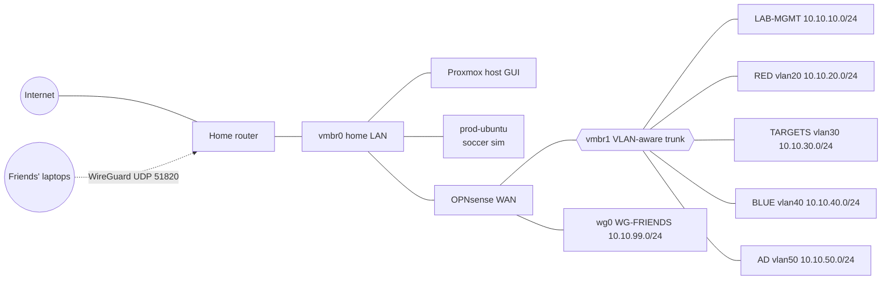

# Start Here

## 1. What you're building

By the end you'll have a segmented, firewalled lab that you can rebuild from code. You'll
control it like a small company network:



All addresses, VMIDs and RAM numbers are in [`network-reference.md`](network-reference.md).

## 2. Check your real capacity first (do this before every project)

On the Proxmox host shell (**Datacenter → node → Shell**):

```bash
free -h                      # "available" is what you can really give to VMs
qm list                      # VMs, their state and allocated memory
pct list                     # LXC containers
pvesm status                 # storage usage (local, local-lvm)
cat /proc/pressure/memory    # memory pressure; "some avg10" > 10 means you're squeezed
```

Or run the preflight script, which prints all of this plus warnings:
`projects/01-lab-foundation/automation/proxmox/00-preflight.sh`.

**Allocated vs. used:** a VM given 4 GB doesn't always use 4 GB. With ballooning and KSM
(Project 01), Linux VMs give memory back and identical Windows pages get merged. Still, plan
using *allocated* memory. Overcommitting RAM on a 16 GB box leads to swapping, and then
everything (including OPNsense, your router) slows down.

## 3. Lab profiles

Only run one profile at a time. Full table in
[`network-reference.md`](network-reference.md#lab-profiles-run-one-at-a-time).

| Profile | Use it for | Needs prod-ubuntu stopped? |
|---|---|---|
| A – Network/Linux | Projects 02, 04, 06, 12 | No |
| B – Active Directory | Project 07 | Yes (or use Kali on your laptop) |
| C – SOC | Project 08 | Recommended |
| D – Game night | Project 10 | Only if you add Windows |
| E – CTF night | Project 09 | No |
| F – Vuln mgmt | Project 12 | No |

`lab-profile.sh A|B|C|D|E|F|stop` (Project 01 automation) starts and stops these for you.

## 4. Where things run

| Workload | Where | Why |
|---|---|---|
| OPNsense, lab VMs | Proxmox VMs | Need full kernels / Windows / isolation |
| Small single services (step-ca, DNS) | Proxmox **LXC** | ~10× less RAM than a VM |
| Multiple Linux web targets | **Docker in one VM** (lab-docker) | One kernel for many apps; easier to isolate in one VLAN |
| BloodHound CE, Autopsy, Wireshark GUI, Burp | **Your laptop** | Heavy GUI/Java apps; save server RAM |
| LLMs for the AI-security project | **Your other computer** (or online labs) | No GPU on the server |
| Kali | Laptop VM (preferred) or VM 201 | Laptop Kali costs the server 0 GB |

Vulnerable targets go in VMs, not LXC containers. An LXC shares the Proxmox kernel, so a
container escape lands on your hypervisor.

## 5. How each project is laid out

```
projects/NN-name/
  README.md        ← the guide (read top to bottom)
  WORKLOG.md       ← your dated lab notebook (fill in as you go)
  deliverables/    ← your professional docs, created from /templates
  automation/      ← SOLUTION: scripts/configs/answer keys. Use only if stuck.
  TASKS.md         ← optional: your own extra "- [ ]" tasks; the progress tracker picks them up
```

Every guide uses the same sections: Goal → Concepts → **Learn alongside** (readings and
videos) → Hours → Resources → Prereqs → Diagram → Build steps → Checkpoints → Exercises →
**Coding exercises** (Python + another language) → Snapshot/teardown → Stretch goals →
Deliverables → Definition of done → Resume bullets → References.

**Study rhythm that works:** watch/read the *Learn alongside* items for a project the week
*before* you build it (commute, phone, between classes), then do the hands-on part in your
lab blocks. Course and language guides: [learning-path](learning-path.md) and
[python-primer](python-primer.md).

**When to open `automation/`:** try the guide first. If you've been stuck on one step for more
than about 45 minutes and searching hasn't helped, read the matching solution script. *Read*
it, understand it, then do the step yourself. Write in your WORKLOG what was wrong. That note
is valuable; it's exactly what interviewers ask about ("tell me about a time you got stuck").

## 6. Creating deliverables

From the repo root:

```bash
scripts/new-doc.sh 01-lab-foundation network-design
# → creates projects/01-lab-foundation/deliverables/network-design.md from templates/
```

See [`documentation-guide.md`](documentation-guide.md) for how to write each type.

## 7. Recommended tooling on your laptop

- A text editor with Markdown preview (VS Code + "Markdown Preview Mermaid Support").
- Git, plus this repo cloned locally.
- Wireshark, an SSH client, a browser with FoxyProxy (for Burp).
- A Kali VM (VirtualBox/VMware/UTM) for joining over WireGuard. This saves server RAM.
- [draw.io](https://app.diagrams.net/) (free) for network diagrams.

## 8. Golden rules

1. Snapshot before every exercise: `qm snapshot <vmid> clean-<date>`.
2. Never put a vulnerable VM on `vmbr0`.
3. Never port-forward anything except WireGuard UDP 51820.
4. Never commit secrets. `.gitignore` blocks common key/config files, but check `git diff`
   before committing anyway.
5. Write the WORKLOG entry *the same day*. Memory fades fast.
