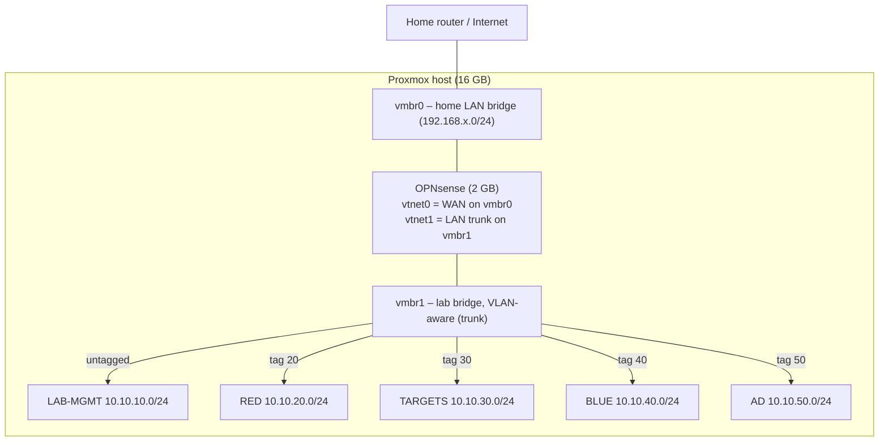

# Project 01: Lab Foundation

> Turn your single flat lab LAN into a **segmented, firewalled network**: five VLANs, a
> default-deny policy, reusable VM templates, and a RAM budget that keeps a 16 GB box stable.
> Every later project builds on this.

## 1. Goal & career relevance

Network segmentation is the most fundamental security control there is, and "design a network"
is the first thing a security engineer is expected to understand. When you finish, you'll own:

- A **network design document** like the ones network and security engineers write.
- A firewall rule set you can explain line by line in an interview.
- A repeatable way to create VMs (templates + cloud-init).

**Hiring skills proved:** networking fundamentals (subnets, VLANs, routing, NAT), firewall
administration, Linux administration, virtualization, documentation.

## 2. Concepts covered

- Layer 2 vs. layer 3: bridges, broadcast domains, **802.1Q VLAN tagging**, trunk vs. access
- Subnetting, default gateways, inter-VLAN routing
- Stateful firewalls, rule order ("first match wins"), default deny, aliases
- NAT (outbound) and why your lab is double-NATed behind your home router
- DHCP and DNS on a firewall (Unbound)
- Hypervisor resource management: ballooning, KSM, ZFS ARC, thin provisioning
- Cloud-init, VM templates, linked clones, snapshots vs. backups

## 3. Estimated time

**10 hours** (about 3 h resource prep + VLANs, 3 h firewall rules + testing, 2 h templates,
2 h documentation).

## 4. Resources & profile

| Item | Cost |
|---|---|
| OPNsense | **reduced** 8 GB → 2 GB |
| Test VM (from template) | 1 GB while testing, then deleted or kept as lab-docker |
| Disk | Ubuntu template ~3 GB actual |

*Two nodes?* Nothing changes for this project. See
[scaling-to-two-nodes](../../docs/scaling-to-two-nodes.md) when you add one.

## 5. Prerequisites

- [ ] Proxmox GUI and shell access; OPNsense GUI access from a machine on 10.10.10.0/24
- [ ] Read [`docs/network-reference.md`](../../docs/network-reference.md). This project *implements* it.
- [ ] Read the [lockout recovery cheat sheet](../../docs/safety-and-legal.md#lockout-recovery-cheat-sheet)
- [ ] Know your **home LAN subnet** (e.g. `192.168.1.0/24`): run `ip a` on the Proxmox host and look at `vmbr0`
- [ ] Create your worklog: it's already at `WORKLOG.md`. Start an entry now.

## 6. Architecture



How a packet from Kali (RED) reaches a target (TARGETS):
`kali → vmbr1 (tagged 20) → OPNsense vtnet1_vlan20 → RED rules allow → routed out
vtnet1_vlan30 → vmbr1 (tagged 30) → target`. The firewall sees *every* inter-segment packet.
That's the point of segmentation.

## 7. Build steps

### Step 1: Inventory and back up what exists (30 min)

1. **Back up OPNsense:** *System → Configuration → Backups → Download configuration*. Save it
   somewhere off the server.
2. Proxmox shell:
   ```bash
   qm list; pct list; free -h; pvesm status
   cat /etc/network/interfaces
   ```
3. Write down in your WORKLOG: VMIDs of OPNsense and prod-ubuntu, their RAM, which bridge
   each NIC uses (`qm config <vmid> | grep net`), and your storage type (LVM-thin or ZFS).
4. Take a snapshot of OPNsense: `qm snapshot <opnsense-vmid> pre-p01`.

> 💡 **Where is prod-ubuntu?** If its NIC is on `vmbr1` (it gets a 10.10.10.x address), it
> sits *inside* the lab next to soon-to-be-vulnerable machines. Move it to `vmbr0` (home LAN);
> Tailscale works from anywhere. That decision is your first **ADR** (template `adr.md`):
> *"ADR-001: Production server lives outside the lab network."*

### Step 2: Free up RAM (45 min)

1. **Shrink OPNsense to 2 GB.** Shut it down (everything in the lab loses internet briefly),
   then *VM → Hardware → Memory → 2048 MiB*. Uncheck **Ballooning Device**; a firewall should
   have fixed memory. Start it again. OPNsense with Unbound and Suricata (P02) runs fine in 2 GB
   for a home lab. Check *Reporting → Health → Memory* after a week.
2. **KSM** (Kernel Samepage Merging) is on by default in Proxmox via `ksmtuned`. It merges
   identical memory pages once host RAM is above about 80%, which helps a lot with several
   Windows VMs. Verify: `systemctl status ksmtuned` and later
   `cat /sys/kernel/mm/ksm/pages_sharing`.
3. **Ballooning for Linux lab VMs:** set *Minimum memory* lower than *Memory* (e.g. 1024/3072)
   so idle VMs hand RAM back.
4. **If your storage is ZFS:** cap the ARC cache to 1 GB (default is up to 50% of RAM!):
   ```bash
   echo "options zfs zfs_arc_max=1073741824" > /etc/modprobe.d/zfs.conf
   update-initramfs -u -k all   # then reboot when convenient
   ```
5. Re-check: `free -h`. Record before/after numbers in your WORKLOG. That's a resume number.

✅ **Checkpoint:** OPNsense is back up at 2 GB, the lab still has internet, and `free -h`
shows about 8–10 GB available.

### Step 3: Make vmbr1 VLAN-aware (15 min)

1. *Node → System → Network → vmbr1 → Edit → ☑ VLAN aware → OK → Apply Configuration.*
2. Verify on the shell:
   ```bash
   grep -A6 'iface vmbr1' /etc/network/interfaces   # should show bridge-vlan-aware yes
   bridge vlan show                                   # lists VLANs per port
   ```
3. OPNsense's vmbr1 NIC must have **no VLAN tag** in Proxmox. Untagged plus VLAN-aware means
   it receives the untagged LAN *and* every tagged VLAN, so it becomes a **trunk port**.

> Why VLAN-aware instead of five separate bridges? One bridge with tags matches how real
> switches work and scales to a second node (trunk over one cable). Write this down as
> **ADR-002**.

### Step 4: Create the VLANs in OPNsense (45 min)

1. *Interfaces → Devices → VLAN* (older versions: *Interfaces → Other Types → VLAN*) → **+** for
   each:

   | Parent | Tag | Description |
   |---|---|---|
   | vtnet1 (your LAN NIC) | 20 | RED |
   | vtnet1 | 30 | TARGETS |
   | vtnet1 | 40 | BLUE |
   | vtnet1 | 50 | AD |

2. *Interfaces → Assignments*: add each new VLAN device, then click it and set:
   ☑ Enable · Description `RED` (etc.) · IPv4 *Static* · `10.10.20.1/24` (`.30.1`, `.40.1`, `.50.1`).
3. *Interfaces → Settings*: make sure **hardware checksum offload, TSO and LRO are disabled**.
   VirtIO NICs plus offloading cause weird dropped-packet bugs on virtualized firewalls.
4. **DHCP** for each new interface. Use the same DHCP service your LAN already uses (*Services
   → Dnsmasq DNS & DHCP*, *Kea DHCP* or *ISC DHCPv4*, depending on your OPNsense version):
   range `.100–.199`, gateway and DNS = the interface IP. For **AD**, set DNS to `10.10.50.10`
   (the future domain controller) *and* `10.10.50.1` as a fallback.
5. **DNS:** *Services → Unbound DNS → General*: listen on all interfaces, register DHCP
   leases. Add host overrides from the network reference later as you build hosts.
6. **Outbound NAT:** leave *Firewall → NAT → Outbound* on **Automatic**. It adds new
   interfaces automatically. Look at the generated rules and note what they do in your design doc.

### Step 5: Firewall aliases and rules (2 h)

OPNsense evaluates rules **per interface, on traffic entering that interface, top to bottom,
first match wins**. Anything not explicitly passed on a non-LAN interface is blocked
(default deny).

**Aliases** (*Firewall → Aliases*):

| Name | Type | Content |
|---|---|---|
| `HOME_NET` | Network | your home subnet, e.g. `192.168.1.0/24` |
| `RFC1918` | Network | `10.0.0.0/8`, `172.16.0.0/12`, `192.168.0.0/16` |
| `LAB_NETS` | Network | `10.10.0.0/16` |
| `WAZUH` | Host | `10.10.40.10` |
| `WAZUH_PORTS` | Port | `1514`, `1515` |
| `SCORING` | Host | `10.10.10.20` |

**Rules.** Turn on **Log** for every block rule. You'll use these logs in Project 02.

**LAB-MGMT (your existing LAN interface):** keep the anti-lockout rule and the default
"allow LAN to any". Add one rule **above** the allow rule:

| # | Action | Source | Destination | Port | Description |
|---|---|---|---|---|---|
| 1 | Block | LAN net | `HOME_NET` | any | Lab must not reach home |

**RED:**

| # | Action | Source | Destination | Port | Description |
|---|---|---|---|---|---|
| 1 | Pass | RED net | RED address | 53 (TCP/UDP) | DNS |
| 2 | Pass | RED net | RED address | ICMP | Ping your own gateway (troubleshooting) |
| 3 | Block | RED net | This Firewall | any | No firewall management (GUI/SSH on *any* firewall IP) |
| 4 | Pass | RED net | TARGETS net | any | Attack targets |
| 5 | Pass | RED net | AD net | any | AD attacks (**disable** when not doing P07) |
| 6 | Block | RED net | `RFC1918` | any | No other private nets (home, mgmt, blue) |
| 7 | Pass | RED net | any | any | Internet for updates/tools |

**TARGETS:**

| # | Action | Source | Destination | Port | Description |
|---|---|---|---|---|---|
| 1 | Pass | TARGETS net | TARGETS address | 53, ICMP | DNS + ping gateway (two rules in the GUI) |
| 2 | Pass | TARGETS net | `WAZUH` | `WAZUH_PORTS` (TCP) | SIEM agents (P08) |
| 3 | Pass *(disabled)* | TARGETS net | `!RFC1918` (invert) | any | ⏱ TEMP egress for installs: enable, install, disable |
| 4 | Block | TARGETS net | any | any | **Default: no egress** (logged) |

> Rule 3 uses an *inverted* destination ("not RFC1918" = internet only), so even when it's
> enabled, targets still can't reach your home LAN. The routine is: enable rule 3 → Apply →
> `apt install …` → disable rule 3 → Apply. Write it down as a runbook. In a company this
> would be a **change request**.

**BLUE:**

| # | Action | Source | Destination | Port | Description |
|---|---|---|---|---|---|
| 1 | Pass | BLUE net | BLUE address | 53, ICMP | DNS + ping gateway |
| 2 | Block | BLUE net | This Firewall | any | No firewall management |
| 3 | Pass | BLUE net | RED net, TARGETS net, AD net | any | Scanning / management |
| 4 | Block | BLUE net | `RFC1918` | any | Nothing else private |
| 5 | Pass | BLUE net | any | any | Internet (updates, threat feeds) |

**AD:**

| # | Action | Source | Destination | Port | Description |
|---|---|---|---|---|---|
| 1 | Pass | AD net | AD address | 53, 123, ICMP | DNS forwarding, NTP, ping gateway |
| 2 | Pass | AD net | `WAZUH` | `WAZUH_PORTS` (TCP) | SIEM agents |
| 3 | Pass *(disabled)* | AD net | `!RFC1918` | any | ⏱ TEMP: Windows Update / activation |
| 4 | Block | AD net | any | any | Default deny (logged) |

Click **Apply changes**, then **back up the config again**.

> 🧠 **Think about it:** Why can't TARGETS reach RED, even though RED can reach TARGETS?
> (Stateful inspection: replies to RED's connections are allowed automatically. New
> connections *from* TARGETS are not. So a reverse shell from a target to Kali is **blocked**.
> You'll need to allow `TARGETS → RED` on specific ports during pentesting projects; P06
> covers that and why real networks do the same egress filtering.)

### Step 5b: Admin access from your laptop (30 min)

Your laptop is on the home LAN, *outside* the lab. Until Project 03 gives you a WireGuard
tunnel, use **routing (not NAT)** to reach the lab from one trusted machine. It's a great
lesson in how routing tables work.

> If you already reach the lab another way (e.g. a jump box), keep it and document it instead.

1. Give your laptop a fixed IP on the home router (DHCP reservation), e.g. `192.168.1.50`.
2. OPNsense alias `ADMIN_LAPTOP` = that IP.
3. *Interfaces → WAN*: uncheck **Block private networks** (your "WAN" *is* a private network).
   Keep **Block bogon networks** checked.
4. *Firewall → Rules → WAN*: `Pass | TCP/UDP/ICMP | ADMIN_LAPTOP → LAB_NETS | any` (log it).
   Optionally also `ADMIN_LAPTOP → This Firewall | 443` for the GUI.
5. Tell your laptop that 10.10.0.0/16 lives behind OPNsense's WAN IP (e.g. `192.168.1.40`):
   ```bash
   # Linux
   sudo ip route add 10.10.0.0/16 via 192.168.1.40
   # macOS
   sudo route -n add -net 10.10.0.0/16 192.168.1.40
   # Windows (admin PowerShell; -p makes it persistent)
   route -p add 10.10.0.0 mask 255.255.0.0 192.168.1.40
   ```
6. Test: `ping 10.10.10.1`, then SSH to a lab VM.

Why this is safe: the rule only allows connections *initiated* by your laptop. Lab hosts
still can't start connections to `HOME_NET` (stateful firewall). Project 03 replaces this
with WireGuard; removing the WAN rule then becomes your first **change request**.

### Step 6: Build the Ubuntu cloud-init template (1 h)

Templates let you create a fresh VM in about 30 seconds. Do it by hand once, in the GUI or
the shell:

```bash
# On the Proxmox host
cd /var/lib/vz/template/iso
wget https://cloud-images.ubuntu.com/noble/current/noble-server-cloudimg-amd64.img

qm create 9000 --name tpl-ubuntu-2404 --ostype l26 --memory 1024 --balloon 512 \
  --cores 2 --cpu host --net0 virtio,bridge=vmbr1 --scsihw virtio-scsi-single --agent enabled=1
qm set 9000 --scsi0 local-lvm:0,import-from=/var/lib/vz/template/iso/noble-server-cloudimg-amd64.img,discard=on,ssd=1
qm set 9000 --ide2 local-lvm:cloudinit --boot order=scsi0 --serial0 socket --vga serial0
qm set 9000 --ciuser labadmin --sshkeys /root/.ssh/authorized_keys --ipconfig0 ip=dhcp
qm disk resize 9000 scsi0 10G
qm template 9000
```

Things to understand (write each in your WORKLOG in your own words):
- `import-from` copies the cloud image into a VM disk.
- `--ide2 …:cloudinit` is a tiny virtual CD that cloud-init reads on first boot to set the
  user, SSH key and IP address.
- `qm template` makes it read-only. **Linked clones** then store only their differences.
- Put *your laptop's* public SSH key in the template (`--sshkeys` takes a file); the example
  above reuses root's authorized keys.

**Make a test clone on TARGETS:**

```bash
qm clone 9000 399 --name test-targets
qm set 399 --net0 virtio,bridge=vmbr1,tag=30 --ipconfig0 ip=10.10.30.99/24,gw=10.10.30.1 \
  --nameserver 10.10.30.1
qm start 399
```

### Step 7: Validate isolation (1 h). Prove it, don't assume it.

From the test VM (`ssh labadmin@10.10.30.99` from a LAB-MGMT machine):

| Test | Command | Expected |
|---|---|---|
| Gateway reachable | `ping -c2 10.10.30.1` | ✅ replies (rule 1 allows ICMP to *its own* gateway only) |
| DNS works | `dig +short example.com @10.10.30.1` | ✅ an IP |
| No internet | `curl -m5 https://example.com` | ❌ timeout |
| No home LAN | `ping -c2 <your home router IP>` | ❌ timeout |
| No Proxmox GUI | `curl -m5 -k https://<proxmox-ip>:8006` | ❌ timeout |
| No firewall mgmt | `curl -m5 -k https://10.10.30.1` | ❌ timeout (GUI only from LAB-MGMT) |
| No LAB-MGMT | `ping -c2 <any 10.10.10.x host>` | ❌ timeout |

Then move the test VM to RED (`qm set 399 --net0 virtio,bridge=vmbr1,tag=20 --ipconfig0
ip=10.10.20.99/24,gw=10.10.20.1 --nameserver 10.10.20.1`, reboot) and confirm: internet ✅,
a TARGETS host ✅, home ❌, firewall GUI ❌.

> Pinging *another* segment's gateway (e.g. 10.10.30.1 from RED) fails by design. Every
> firewall IP is "This Firewall", which only LAB-MGMT may talk to. Test cross-segment access
> against real **hosts**, not gateways.

Watch the blocks happen in *Firewall → Log Files → Live View* while you test.

The script `automation/proxmox/validate-isolation.sh` runs this matrix for you **after**
you've done it by hand once.

### Step 8: Snapshots, backups and the profile helper (30 min)

1. *Datacenter → Backup → Add*: weekly backup of OPNsense (and prod-ubuntu) to `local`,
   mode *Snapshot*, keep last 3. OPNsense backups are tiny.
2. Learn the difference: a **snapshot** lives on the same disk (fast undo, not a backup); a
   **backup** (vzdump) is a separate file (survives VM deletion, but not disk failure; ideally
   copy it off the box).
3. Read `automation/proxmox/lab-profile.sh` and set its variables (prod-ubuntu VMID). You'll
   use it from now on to start and stop lab profiles.

## 8. Checkpoints

- [ ] OPNsense running at 2 GB; `free -h` before/after recorded
- [ ] `bridge vlan show` lists VLANs 20/30/40/50 on OPNsense's tap interface once VMs use them
- [ ] All 5 segments have a gateway, DHCP and DNS
- [ ] Isolation matrix tested from TARGETS and RED, with screenshots of blocked traffic in the live log
- [ ] Template 9000 exists; a linked clone boots with the right IP in under a minute
- [ ] OPNsense config backup downloaded *after* the changes

## 9. Exercises

1. **Subnet math:** You need a new segment for 50 IoT devices. What's the smallest subnet?
   Pick a free range in 10.10.0.0/16 that doesn't overlap. (Answer: `/26`, e.g. 10.10.60.0/26.)
2. **Break it on purpose:** Remove the VLAN tag from the test VM's NIC. What IP does it get?
   Which firewall rules now apply to it? Why is that dangerous? (It lands on LAB-MGMT with
   *admin* rights.) Write what this teaches about VLAN hopping and misconfigured ports.
3. **Rule order:** Move RED rule 6 ("pass any") to the top. What can RED reach now? Test it,
   then put it back. Explain "first match wins" in one paragraph.
4. **Explain NAT:** trace one packet from the test VM to example.com and back. List every
   address translation (there are two: OPNsense and your home router).

## 10. Python exercise

Write `ram_report.py` for the Proxmox host. It should:
- run `pvesh get /cluster/resources --type vm --output-format json`
- print each VM/CT's name, status and allocated RAM
- sum the RAM of *running* guests, compare it to the host total, and warn above 85%

Bonus: accept a profile letter (A–F) and print whether that profile would fit right now.
Solution: `automation/python/ram_report.py`.

## 11. Snapshot / teardown

- Delete the test VM when done (`qm destroy 399`) or keep it as a scratch box.
- Snapshot OPNsense: `qm snapshot <vmid> p01-done`.

## 12. Stretch goals

- Enable **2FA** on Proxmox and OPNsense ([safety doc](../../docs/safety-and-legal.md)).
- Set up an OPNsense **config backup to git** (*System → Configuration → Backups → Git*). It's
  version control for your firewall.
- Create a **Debian 12 LXC template** for lightweight services (used in P12 for step-ca).
- Add a cloud-init **vendor snippet** that installs `qemu-guest-agent` automatically (see
  `automation/proxmox/vendor-base.yaml`).

## 13. Documentation deliverables

Create these with `scripts/new-doc.sh 01-lab-foundation <template>`:

| Deliverable | Template | Notes |
|---|---|---|
| Network design doc | `network-design` | The most important doc in the repo. IPAM, diagram, firewall matrix, validation test results. |
| ADR-001: prod server placement | `adr` | suffix `001-prod-placement` |
| ADR-002: VLAN-aware bridge vs. multiple bridges | `adr` | suffix `002-vlan-aware` |
| Build runbook: "Create a lab VM from template" | `runbook-sop` | suffix `create-vm` |
| Backup/restore SOP | `runbook-sop` | suffix `backup-restore`; *test a restore* of OPNsense config |

## 14. Definition of done

- [ ] All checkpoints ticked
- [ ] Network design doc complete, including the validation table with real results
- [ ] 2 ADRs + 2 runbooks written
- [ ] WORKLOG has entries for every session, with total hours
- [ ] Python exercise done (yours or solution understood)
- [ ] Resume bullet drafted
- [ ] Path-finder rating filled in ([career-paths](../../docs/career-paths.md#path-finder-checklist))

## 15. Resume bullets

- *Designed and deployed a segmented homelab network on Proxmox VE with an OPNsense firewall,
  5 VLANs (red, blue, targets, AD, management) and a default-deny inter-VLAN policy; validated
  isolation with a documented test matrix.*
- *Reduced hypervisor memory overhead by <X> GB through right-sizing, KSM and ballooning,
  enabling <N> concurrent lab VMs on a 16 GB host.*
- *Built cloud-init VM templates enabling new Linux lab hosts to be provisioned in under a
  minute via linked clones.*

## 16. References

- Proxmox: [Network configuration (VLANs)](https://pve.proxmox.com/wiki/Network_Configuration) ·
  [Cloud-Init support](https://pve.proxmox.com/wiki/Cloud-Init_Support) ·
  [Dynamic memory management (ballooning, KSM)](https://pve.proxmox.com/wiki/Dynamic_Memory_Management)
- OPNsense: [VLAN and interfaces](https://docs.opnsense.org/manual/other-interfaces.html) ·
  [Firewall rules](https://docs.opnsense.org/manual/firewall.html) ·
  [Aliases](https://docs.opnsense.org/manual/aliases.html)
- benheater.com: [Proxmox lab series (OPNsense, VLANs)](https://benheater.com/)
- Practical networking: [Subnetting mastery (free)](https://www.practicalnetworking.net/stand-alone/subnetting-mastery/)
