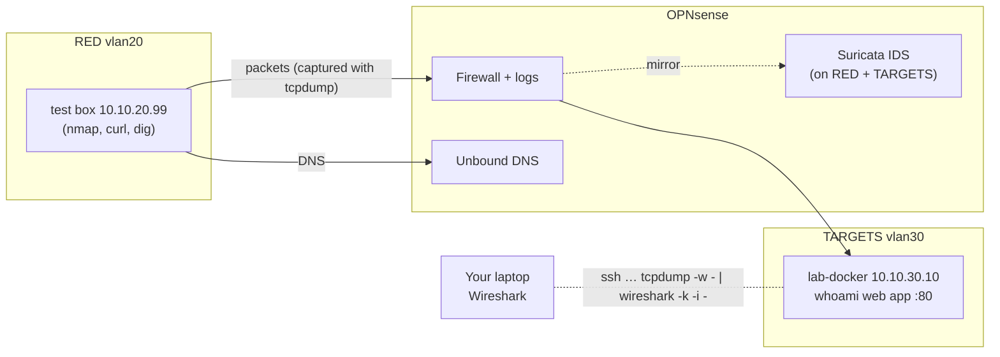

# Project 02: Networking Deep Dive

> Watch the network you built actually work, packet by packet: ARP, DHCP, DNS, TCP, HTTP and
> TLS, scans, and an IDS that flags them. Then analyze real-world malicious traffic.

## 1. Goal & career relevance

Every security role assumes you can read packets. SOC analysts pivot from alerts into PCAPs,
pentesters need to know what their scans look like on the wire, and network and security
engineers troubleshoot with `tcpdump` daily. Interviewers love *"what happens when you type a
URL into a browser?"*. After this project you'll be able to answer it with screenshots.

**Hiring skills proved:** TCP/IP and OSI fundamentals, DNS/DHCP, packet analysis
(Wireshark/tcpdump), IDS (Suricata), firewall troubleshooting, Python for data analysis.

## 2. Concepts covered

- OSI vs. TCP/IP models, and where each protocol lives
- ARP and layer-2 trust (and why VLANs contain ARP spoofing)
- DHCP DORA, DNS resolution (recursive vs. authoritative, `dig +trace`), caching
- TCP 3-way handshake, teardown, RST, window/flags; UDP; ICMP
- Port scan types (SYN, connect, UDP) and how they look on the wire and in firewall logs
- HTTP cleartext vs. TLS (ClientHello, SNI, certificates)
- Routing between VLANs, TTL, traceroute
- Network IDS: signatures, rule categories, false positives

### Learn alongside (read / watch)

| Resource | Why | Time |
|---|---|---|
| [Kurose & Ross](https://gaia.cs.umass.edu/kurose_ross/) Ch. 2 (DNS, HTTP) and Ch. 3 (TCP/UDP), plus their free **Wireshark labs** on the same site | The theory behind every lab here; the Wireshark labs are perfect extra practice | 4 h |
| Chris Greer (YouTube): "TCP handshake", "Wireshark filters", "TCP retransmissions" | Best practical packet-analysis teacher | 2 h |
| [Stanford CS 155](https://cs155.stanford.edu/) network security lectures (slides) | Attacks on ARP, DNS, TCP, and how they're defended | 1.5 h |
| [Practical Networking](https://www.practicalnetworking.net/series/packet-traveling/): ARP and encapsulation articles | Pairs with Lab 1 | 30 min |
| Computerphile (YouTube): "TCP Meltdown", "How DNS works", "TLS handshake" | Quick intuition | 45 min |
| [Beej's Guide to Network Programming](https://beej.us/guide/bgnet/) chapters 1–5 | What sockets really are (for the C++ exercise) | 2 h |
| [Suricata docs: Rules intro](https://docs.suricata.io/en/latest/rules/intro.html) | Read a signature like an analyst | 30 min |

## 3. Estimated time

**8 hours** (5 h labs, 1 h PCAP challenge, 2 h report + runbook).

## 4. Resources & profile

**Profile A (light).** You create **lab-docker (VMID 301)** here; Projects 06, 08, 09 and 12
reuse it.

| VM | Segment | RAM | Notes |
|---|---|---|---|
| lab-docker (301) | TARGETS 10.10.30.10 | 3 GB (balloon min 1 GB) | Ubuntu clone + Docker; runs a test web app now |
| test box (399) | RED 10.10.20.99 | 1 GB | The Project 01 test VM, or Kali on your laptop |
| OPNsense Suricata | — | +300–500 MB inside OPNsense | Watch OPNsense memory. If it swaps, raise OPNsense to 3 GB. |

## 5. Prerequisites

- [ ] Project 01 complete (VLANs, rules, template, admin access)
- [ ] Wireshark installed on your laptop
- [ ] Skim: [Wireshark display filter reference](https://www.wireshark.org/docs/dfref/) and the
      "TCP/IP Guide" sections on ARP/DHCP/TCP, or Chris Greer's YouTube videos

## 6. Architecture



## 7. Build steps

### Step 1: Create lab-docker (30 min)

1. Clone the template into TARGETS:
   ```bash
   qm clone 9000 301 --name lab-docker
   qm set 301 --net0 virtio,bridge=vmbr1,tag=30 --ipconfig0 ip=10.10.30.10/24,gw=10.10.30.1 \
     --nameserver 10.10.30.1 --memory 3072 --balloon 1024 --cores 2
   qm disk resize 301 scsi0 40G
   qm start 301
   ```
2. **Enable the TEMP egress rule on TARGETS** (P01). Then on lab-docker:
   ```bash
   sudo apt update && sudo apt install -y qemu-guest-agent tcpdump tshark docker.io docker-compose-v2
   sudo usermod -aG docker labadmin && sudo systemctl enable --now qemu-guest-agent
   sudo docker pull traefik/whoami          # tiny web server that echoes your request
   ```
3. **Disable the TEMP egress rule.** (Do this every time. It's a habit, not a step.)
4. Run the test app: `sudo docker run -d --name whoami -p 80:80 --restart unless-stopped traefik/whoami`

### Step 2: Capture basics (30 min)

On lab-docker:
```bash
ip -br a                                  # find the interface name (e.g. eth0 / ens18)
sudo tcpdump -i eth0 -nn -c 20            # 20 packets, no name/port resolution
sudo tcpdump -i eth0 -nn 'not port 22'    # hide your own SSH session
sudo tcpdump -i eth0 -nn -w /tmp/web.pcap 'port 80'
```

**Live capture straight into Wireshark on your laptop:**
```bash
ssh labadmin@10.10.30.10 "sudo tcpdump -i eth0 -U -w - 'not port 22'" | wireshark -k -i -
```

**Capture on the firewall:** *Interfaces → Diagnostics → Packet Capture*. Pick the RED or
TARGETS interface, start, generate traffic, stop, and download the `.pcap`. This is how you see
traffic *between* VLANs from the router's point of view.

### Step 3: The labs (≈3.5 h)

Do each lab, save the PCAP, and take a screenshot of the key packets for your report.

**Lab 1: ARP and layer 2.**
1. On lab-docker: `sudo ip neigh flush all`, start `sudo tcpdump -i eth0 -nn arp`.
2. From lab-docker: `ping -c1 10.10.30.1`. Observe *who-has* / *is-at*.
3. Question: from the RED test box you ping 10.10.30.10. Do you see the test box's ARP
   request on lab-docker? Why not? (Different broadcast domain. The firewall ARPs on your
   behalf. **This is why VLANs stop ARP spoofing across segments.**)

**Lab 2: DHCP DORA.**
1. Clone a throwaway VM with `--ipconfig0 ip=dhcp` on TARGETS, and capture on the TARGETS
   interface in OPNsense while it boots.
2. Filter `dhcp` (or `bootp`). Identify Discover → Offer → Request → Ack, the lease time, and
   the options (router, DNS).

**Lab 3: DNS.**
1. From the test box: `dig example.com @10.10.20.1` and `dig +trace example.com` (the trace
   only works from RED, which has internet. Explain why).
2. Capture: find the query ID, flags (RD, RA), answer TTL. Run the query twice. Why is the
   second one faster? (Unbound cache.)
3. In OPNsense, enable *Unbound → Advanced → Log queries* briefly and watch *Log Files*. You've
   just built the data source that DNS-based detections (and AdGuard Home) use.

**Lab 4: TCP and scans.**
1. `curl http://10.10.30.10/` from the test box and capture: annotate SYN, SYN-ACK, ACK, the
   HTTP request, FIN/ACK teardown. Note sequence/ack numbers (Wireshark → *relative*).
2. Install nmap on the test box (RED has internet) and run, capturing each separately:
   ```bash
   sudo nmap -sS -p 1-1000 10.10.30.10     # SYN "half-open" scan
   nmap -sT -p 1-1000 10.10.30.10          # full connect scan
   sudo nmap -sU --top-ports 20 10.10.30.10
   sudo nmap -sV -p 80 10.10.30.10         # version detection
   ```
   For closed ports, what does the target send back? (RST/ACK.) For UDP? (ICMP port
   unreachable, or nothing.) Which scan is stealthier and why? Look at the whoami container
   logs (`docker logs whoami`) for the `-sT` and `-sV` scans.
3. Now scan something the firewall blocks: `nmap -sS -p 22,80 10.10.40.10`. Find the drops in
   *Firewall → Log Files → Live View*. Filtered vs. closed: what's the difference on the wire?

**Lab 5: HTTP vs. TLS.**
1. `curl -d 'user=alice&pass=Secret123' http://10.10.30.10/login`. Find the password in the
   capture (*Follow → HTTP Stream*). This is why cleartext protocols are a finding.
2. From the test box: `curl https://example.com`. Capture and find the **TLS ClientHello**,
   the **SNI** (server name, visible in cleartext!) and the cipher suite. Discuss: what can a
   network defender still see with TLS? (SNI, IPs, timing, sizes, JA3/JA4 fingerprints.)

**Lab 6: Routing and TTL.**
1. `traceroute -n 10.10.30.10` (or `mtr`) from RED. How many hops? Which IP is hop 1?
2. `traceroute -n 1.1.1.1`. Identify your OPNsense, your home router, and your ISP. Explain
   double NAT in one paragraph.

### Step 4: Suricata IDS on OPNsense (45 min)

1. *Services → Intrusion Detection → Administration*:
   - ☑ Enabled, ☐ IPS mode (start in **IDS** mode; alert only), Pattern matcher: default
   - Interfaces: **RED, TARGETS** (that's where attacks happen; fewer interfaces = less RAM)
   - Home networks: `10.10.0.0/16`
2. *Download* tab: enable **ET open** rulesets (start with `emerging-scan`, `emerging-web_server`,
   `emerging-exploit`, `emerging-policy`) → *Download & Update rules*. RED's internet access
   makes this work, since OPNsense fetches the rules itself.
3. *Schedule*: daily rule update.
4. Re-run the nmap scans from Lab 4. *Alerts* tab: find the ET SCAN alerts. Open one and note
   the SID, the rule text and the matched packet.
5. Check *System → Diagnostics → Activity* / `top` for Suricata's memory use. Record it.

> 🧠 **IDS vs. IPS:** in IPS mode Suricata *drops* matching packets. Why might a SOC run IDS
> mode first? (False positives in IPS mode cause outages. Tune in IDS mode, then block.)

### Step 5: Real-world PCAP challenge (1 h)

1. Pick a beginner exercise from [malware-traffic-analysis.net/training-exercises](https://www.malware-traffic-analysis.net/training-exercises.html)
   (they come with questions and answers).
2. ⚠️ The zips are password-protected for a reason: the PCAPs can contain **real malware**.
   Open them in Wireshark only; don't export objects onto your laptop. Analyze them inside
   a lab VM if you want to extract files.
3. Answer the exercise questions: infected host, user, malicious domains, and what happened.
   This is real SOC analyst work.

## 8. Checkpoints

- [ ] lab-docker running with whoami on :80; TEMP egress rule **disabled** again
- [ ] 6 lab PCAPs saved (outside git: `.gitignore` blocks `*.pcap`) with annotated screenshots
- [ ] Suricata alerting on your nmap scans
- [ ] One malware-traffic-analysis exercise answered

## 9. Exercises

1. Draw the full "type `http://10.10.30.10` into a browser on the test box" sequence: ARP →
   (DNS if it was a name) → TCP → HTTP → teardown, with which device does what.
2. Write 5 Wireshark display filters from memory: SYN-only packets, DNS queries for one
   domain, HTTP POSTs, TLS ClientHellos, traffic between two hosts.
3. Firewall troubleshooting drill: have a friend (or past you) secretly disable one OPNsense
   rule, then find the broken flow using *only* firewall logs, packet captures and `ping` /
   `curl`. Write the steps down. That's your **firewall troubleshooting runbook**.
4. Subnetting: run `automation/python/subnet_quiz.py` until you get 10/10 twice in a row.

## 10. Coding exercises

**Before you start:** [Python primer](../../docs/python-primer.md) sections 1, 4, 6, 10 and 11.

**Other languages: C++ with libpcap.** Rewrite the core of `pcap_summary.py` in C++ using
libpcap: open a PCAP, cast the raw bytes to Ethernet/IP/TCP header structs, count protocols and
flag SYN scans. You'll learn **network byte order** (`ntohs`), why header lengths are stored in
32-bit words, and why Wireshark is written in C. Compare its speed to the Python version on a
large PCAP (`time ./sniffer -r big.pcap`).
- Learn first: [CS50x weeks 1–4](https://cs50.harvard.edu/x/) (C, memory, pointers) and
  [Beej's Guide](https://beej.us/guide/bgnet/) ch. 1–5;
  [libpcap tutorial (tcpdump.org)](https://www.tcpdump.org/pcap.html).
- Solution: `automation/cpp/sniffer.cpp` (`make`, then `./sniffer -r file.pcap`).

**Python:**

Write `pcap_summary.py` using [scapy](https://scapy.readthedocs.io/) that takes a PCAP and prints:
- the top 5 talkers (source IP → packet count)
- protocol counts (TCP/UDP/ICMP/ARP)
- every DNS query name
- a **scan detector**: any source that sent SYNs to more than 20 distinct ports on one host

Run it on your nmap PCAP. Did it flag the scanner? Run it on the malware-traffic PCAP.
Solution: `automation/python/pcap_summary.py`. (Bonus: `subnet_quiz.py` uses only the
standard-library `ipaddress` module. Read it.)

## 11. Snapshot / teardown

- `qm snapshot 301 p02-clean` (lab-docker is reused a lot).
- Leave Suricata on for RED/TARGETS. P08 and P10 use its alerts. If OPNsense RAM is tight,
  disable it between sessions.
- Turn off Unbound query logging (it fills the disk).

## 12. Stretch goals

- Send OPNsense firewall + Suricata logs to a remote syslog (Wazuh in P08 can ingest them).
- Try **Zeek** on lab-docker (`docker run zeek/zeek`) against your PCAPs. It produces
  `conn.log`, `dns.log` and `http.log`, the "network metadata" many SOCs use.
- Install **AdGuard Home** in an LXC on LAB-MGMT and point a segment's DNS at it (this
  previews the AdGuard service you planned for home).
- ARP spoofing demo: temporarily put two VMs plus the test box in the *same* VLAN and run
  `arpspoof`/`bettercap`. Watch the MITM in Wireshark, then explain the mitigations (DHCP
  snooping, dynamic ARP inspection, port security).

## 13. Documentation deliverables

| Deliverable | Template |
|---|---|
| Packet analysis report covering Labs 1–6 (annotated) **or** the malware-traffic exercise | `packet-analysis-report` |
| Firewall troubleshooting runbook (from exercise 3) | `runbook-sop` (suffix `firewall-troubleshooting`) |

## 14. Definition of done

- [ ] Checkpoints ticked, exercises answered in WORKLOG
- [ ] Packet analysis report with at least 6 annotated figures
- [ ] Runbook tested by actually using it once
- [ ] `pcap_summary.py` working (yours or the solution, understood)
- [ ] Resume bullet + path-finder rating

## 15. Resume bullets

- *Analyzed network traffic with Wireshark/tcpdump across a 5-VLAN lab, documenting ARP,
  DHCP, DNS, TCP and TLS behavior and the on-wire signatures of SYN, connect and UDP scans.*
- *Deployed Suricata IDS (ET Open rules) on an OPNsense firewall and validated detection of
  reconnaissance scans; wrote a Python/scapy tool that summarizes PCAPs and flags port scans.*

## 16. References

- Wireshark: [User's Guide](https://www.wireshark.org/docs/wsug_html_chunked/) ·
  [Sample captures](https://wiki.wireshark.org/SampleCaptures)
- [malware-traffic-analysis.net exercises](https://www.malware-traffic-analysis.net/training-exercises.html)
- OPNsense: [Intrusion Prevention System](https://docs.opnsense.org/manual/ips.html) ·
  [Packet capture](https://docs.opnsense.org/manual/diagnostics_interfaces.html)
- Nmap: [Port scanning techniques](https://nmap.org/book/man-port-scanning-techniques.html)
- [Practical Packet Analysis (book, No Starch)](https://nostarch.com/packetanalysis3)
- Chris Greer's Wireshark videos (YouTube)
