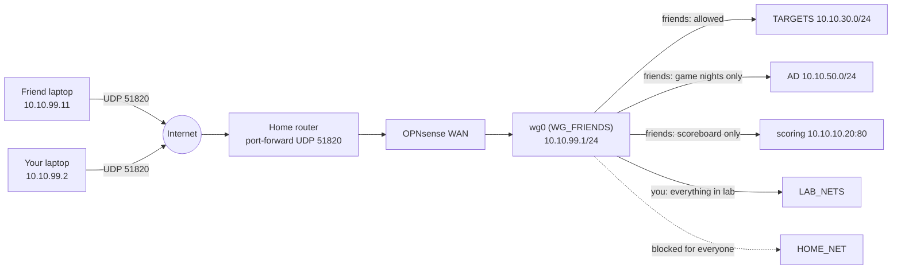

# Project 03: WireGuard Remote Access for You and Your Friends

> Build a VPN on OPNsense so you and your friends can reach the lab from anywhere, with each
> person getting **only the access they need**. Tailscale is the fallback if the WireGuard route
> gets messy.

## 1. Goal & career relevance

Remote access is one of the most common sources of breaches (exposed VPNs, shared
credentials, flat access once you're "in"). Designing a VPN with **per-user least privilege**,
proper key handling and a revocation process is exactly what security and network engineers
do. Writing the access *policy* is GRC work.

**Hiring skills proved:** VPN/tunneling, public-key cryptography in practice, NAT traversal
and port forwarding, least-privilege firewall design, access policy writing, change management.

## 2. Concepts covered

- WireGuard: Curve25519 key pairs, peers, `AllowedIPs` ("cryptokey routing"), UDP, keepalives
- Split tunnel vs. full tunnel
- Port forwarding through double NAT; dynamic DNS
- Per-peer firewall rules, identity-based access
- Key lifecycle: generation, distribution (public keys only!), rotation, revocation
- Change management: replacing the P01 admin WAN rule safely

### Learn alongside (read / watch)

| Resource | Why | Time |
|---|---|---|
| Computerphile (YouTube): "Public Key Cryptography", "Diffie-Hellman Key Exchange", "Elliptic Curves" | Intuition for what your key pairs are doing | 45 min |
| [Christof Paar: Introduction to Cryptography](https://www.crypto-textbook.com/) lectures on Diffie–Hellman and elliptic curves | University-level, still very clear | 3 h |
| [Dan Boneh: Cryptography I](https://www.coursera.org/learn/crypto) (audit free), weeks 5–6 (key exchange, public-key encryption) | The rigorous version | optional |
| [WireGuard whitepaper](https://www.wireguard.com/papers/wireguard.pdf) sections 1–2 and 5 | Cryptokey routing and the handshake, from the author | 1 h |
| [CS50 Cybersecurity](https://cs50.harvard.edu/cybersecurity/) lecture "Securing Data" | Encryption and keys in plain language | 1.5 h |
| [Tailscale blog: How NAT traversal works](https://tailscale.com/blog/how-nat-traversal-works) | The best explanation of NAT traversal on the internet | 1 h |
| [NIST SP 800-77r1: Guide to IPsec VPNs](https://csrc.nist.gov/pubs/sp/800/77/r1/final) sections 1–3 | How organizations plan VPNs (good for your policy doc) | optional |

## 3. Estimated time

**6 hours** (3 h build + friend onboarding, 1 h troubleshooting, 2 h policy/runbook/CR).

## 4. Resources & profile

WireGuard runs inside OPNsense, so it uses **about 0 extra RAM**. The Tailscale fallback is a
256 MB LXC (VMID 220, RED, `10.10.20.20`).

## 5. Prerequisites

- [ ] Projects 01–02 done; lab-docker (301) running on TARGETS
- [ ] Admin access to your **home router** (for one port forward)
- [ ] A free dynamic-DNS name (e.g. [DuckDNS](https://www.duckdns.org)) if your home IP
      changes, which it usually does
- [ ] Check your ISP gives you a real public IPv4: if the router's WAN IP is in
      `100.64.0.0/10` you're behind **CGNAT** and inbound WireGuard won't work → use the
      Tailscale fallback (section 7B)
- [ ] WireGuard client installed on your laptop and phone (wireguard.com/install)

## 6. Architecture



Address plan for the tunnel (add it to your network design doc):

| Address | Who |
|---|---|
| 10.10.99.1 | OPNsense (wg0) |
| 10.10.99.2 | your laptop (admin) |
| 10.10.99.3 | your phone (admin, optional) |
| 10.10.99.11–.49 | friends (one /32 each) |

## 7A. Build: WireGuard on OPNsense

### Step 1: Server instance (30 min)

1. *VPN → WireGuard → Instances* (called *Local* in older versions) → **+**:
   - Name `wg-lab`, Listen port `51820`, Tunnel address `10.10.99.1/24`
   - Click the gear to **generate a key pair**. Copy the **public** key; you'll give it to peers.
2. *VPN → WireGuard → Settings*: ☑ Enable WireGuard → Apply.
3. *Interfaces → Assignments*: assign the new `wg0` device → enable it, description
   `WG_FRIENDS`, IPv4 config **None** (the instance already sets the address).
   Assigning it gives you a dedicated rules tab, which is the whole point.
4. *Firewall → Rules → WAN*: `Pass | UDP | any → WAN address | 51820` with description
   "WireGuard".

### Step 2: Home router port forward + DNS (30 min)

1. Give OPNsense's WAN a **DHCP reservation** on your home router (e.g. `192.168.1.40`).
2. Port forward **UDP 51820 → 192.168.1.40:51820**. Nothing else, ever.
3. Dynamic DNS: run the DuckDNS updater on the home router if it supports it, or as a cron
   job on prod-ubuntu. OPNsense's `os-ddclient` plugin also works, but it must detect the IP
   via a web service (the WAN interface IP is private).
4. Find your public IP (`curl ifconfig.me` from prod-ubuntu) and check the DDNS name resolves
   to it.

### Step 3: Your admin peer first (30 min)

On your laptop, **generate the key pair on the device that will use it**:

```bash
wg genkey | tee laptop.key | wg pubkey > laptop.pub    # Linux/macOS (Windows app: "Add empty tunnel")
```

The private key never leaves the laptop. Only `laptop.pub` goes to the server. This is the core
idea of public-key crypto, and it's why you never "send someone their VPN key".

OPNsense *VPN → WireGuard → Peers* (older: *Endpoints*) → **+**: Name `admin-laptop`, Public
key = `laptop.pub`, Allowed IPs `10.10.99.2/32`, Instance `wg-lab`. Apply.

Laptop tunnel config:

```ini
[Interface]
PrivateKey = <contents of laptop.key>
Address = 10.10.99.2/32

[Peer]
PublicKey = <OPNsense wg-lab public key>
Endpoint = <yourname>.duckdns.org:51820
AllowedIPs = 10.10.0.0/16          # split tunnel: only lab traffic goes through the VPN
PersistentKeepalive = 25
```

> 🧠 **AllowedIPs means two things.** On the *client* it's a routing table ("send these
> destinations into the tunnel"). On the *server* it's an access list ("accept packets from
> this peer only with these source IPs"). That's "cryptokey routing". Explain it in your own
> words in the WORKLOG.

**Test from outside your home** (phone hotspot): connect, then `ping 10.10.99.1`.

### Step 4: Rules on WG_FRIENDS (45 min)

Aliases:

| Alias | Type | Content |
|---|---|---|
| `WG_ADMINS` | Host(s) | 10.10.99.2, 10.10.99.3 |
| `WG_FRIENDS_NET` | Network | 10.10.99.0/24 |
| `REV_SHELL_PORTS` | Port(s) | 4444:4460 |

*Firewall → Rules → WG_FRIENDS* (top to bottom, log blocks):

| # | Action | Source | Destination | Port | Description |
|---|---|---|---|---|---|
| 1 | Pass | `WG_ADMINS` | `LAB_NETS` | any | Admins reach the whole lab |
| 2 | Pass | `WG_ADMINS` | This Firewall | 443, 22 | Admins manage the firewall |
| 3 | Block | WG_FRIENDS net | This Firewall | any | Friends can't touch the firewall |
| 4 | Pass | WG_FRIENDS net | TARGETS net | any | Friends attack targets / CTF host |
| 5 | Pass | WG_FRIENDS net | `SCORING` | 80 | Scoreboard |
| 6 | Pass *(disabled)* | WG_FRIENDS net | AD net | any | ⏱ Game nights only |
| 7 | Block | any | any | any | Everything else (logged) |

And so friends can catch reverse shells during games, add on **TARGETS** (above its final block):

| Action | Source | Destination | Port | Description |
|---|---|---|---|---|
| Pass *(disabled)* | TARGETS net | WG_FRIENDS net | `REV_SHELL_PORTS` | ⏱ Game nights: reverse shells to players |

> Why can't a target VM reach your friends' home networks? Two layers: (1) the server only
> knows each friend as one `/32`, so the lab can only ever route to the friend's *tunnel IP*;
> (2) the TARGETS → WG rule is off by default and port-limited. Tell friends to join from a
> **Kali VM**, not their main OS, and keep their own firewall on.

### Step 5: Onboard a friend (30 min per friend, the first time)

Follow (and write!) the onboarding runbook:
1. Friend reads and agrees to the Rules of Engagement and the VPN access policy.
2. Friend generates their own key pair and sends **only the public key** (text message is fine;
   it's public).
3. You add the peer (`friend-<name>`, `10.10.99.1X/32`) and record it in the peer register
   (who, IP, date added, expiry).
4. You send them the client config **without** a private key; they paste their own.
   `automation/peer-config.sh` builds this file.
5. Test together: handshake shows in *VPN → WireGuard → Status*; they can `curl
   http://10.10.30.10`, can't reach `10.10.10.1`, and can't reach `10.10.40.10`.

### Step 6: Retire the P01 WAN admin rule (change request) (20 min)

Now that you have VPN access, the WAN rule `ADMIN_LAPTOP → LAB_NETS` is unnecessary attack
surface. Write a **change request** (template `change-request`): justification, rollback (re-
enable rule), test plan (VPN still works from outside *and* from inside your home). Then disable
the rule, test, and delete it a week later. This is how real changes are made.

> Connecting to WireGuard from *inside* your home LAN using the DDNS name needs NAT
> reflection (hairpin NAT) on your home router. If that fails, use the OPNsense WAN IP as the
> Endpoint when at home. Note it in the runbook.

### Step 7: Revocation drill (10 min)

Disable a test peer, confirm the client loses access within seconds, and record it. Policy
says: peers expire after 90 days or when the friend stops playing. Revoke, don't just forget.

## 7B. Fallback: Tailscale subnet router

Use this if you're behind CGNAT, the home router can't port-forward, or WireGuard is eating all
your time. (Write an ADR either way. Choosing the simpler tool is a legitimate engineering
decision.)

1. Create a Debian 12 LXC (VMID 220, 256 MB, 2 GB disk) on **RED** (`tag=20`, `10.10.20.20`).
   Putting it in RED means friends inherit RED's firewall rules: TARGETS and AD yes, BLUE /
   MGMT / home no.
2. Allow TUN in the container (Proxmox host, `/etc/pve/lxc/220.conf`):
   ```
   lxc.cgroup2.devices.allow: c 10:200 rwm
   lxc.mount.entry: /dev/net/tun dev/net/tun none bind,create=file
   ```
3. In the LXC: install Tailscale ([official install script](https://tailscale.com/download/linux)),
   enable IP forwarding, then
   `tailscale up --advertise-routes=10.10.30.0/24 --advertise-tags=tag:lab-router`.
4. Approve the route in the admin console, invite friends to your tailnet, and apply the ACL in
   `automation/tailscale/acl.hujson` (friends → TARGETS + scoreboard only). Check Tailscale's
   current free-plan user limits first.

## 8. Checkpoints

- [ ] Your laptop connects from outside the house (hotspot) and reaches the whole lab
- [ ] One friend (or a second device acting as "friend") reaches TARGETS but **not** MGMT/BLUE/home
- [ ] Block hits for the friend's forbidden attempts visible in the live log
- [ ] P01 WAN admin rule removed via a change request
- [ ] Revocation drill done

## 9. Exercises

1. Why does WireGuard use UDP rather than TCP? (TCP-over-TCP meltdown; it's connectionless and
   silent to unauthenticated packets, so the port doesn't even look open to scanners. Try
   `nmap -sU -p 51820 <your public IP>` from a phone hotspot.)
2. A friend's laptop is stolen. List the exact steps to contain it. (Disable peer → check
   logs for activity after theft → rotate any lab creds they had.)
3. Compare WireGuard vs. OpenVPN vs. IPsec vs. Tailscale in a table: crypto agility,
   performance, NAT traversal, management overhead. Put it in your ADR.
4. Capture on OPNsense's WAN during a handshake. What can an observer on the internet learn?
   (Your IP, their IP, packet sizes and timing. No contents and no identities.)

## 10. Coding exercises

**Before you start:** [Python primer](../../docs/python-primer.md) sections 1, 3 and 8.

**Other languages: Bash + reading Go.** Extend `automation/peer-config.sh` so it also prints a
QR code for phone peers (`qrencode`). Optional: do the [Tour of Go](https://go.dev/tour/), then
skim [wireguard-go](https://git.zx2c4.com/wireguard-go/)'s `device/noise-protocol.go` and find
where the handshake messages from the whitepaper are built. Reading real security code is a
skill in itself.

**Python:**

On OPNsense's shell, `wg show all dump` prints tab-separated peer stats. Write
`wg_status.py` that parses that output (piped in or from a file) and prints, per peer: name
(map public key → name from a small CSV peer register), tunnel IP, last-handshake age, and
bytes rx/tx. Flag peers with **no handshake in 30 days** as *revocation candidates*.
Solution: `automation/python/wg_status.py`.

## 11. Snapshot / teardown

- Back up the OPNsense config (it now contains the WireGuard private key, so store the backup
  securely and **never commit it**).
- Disable rule 6 (AD) and the TARGETS → WG reverse-shell rule when not in a game.

## 12. Stretch goals

- Add your phone as a peer with a QR code (`qrencode -t ansiutf8 < phone.conf`).
- Make a **full-tunnel** profile for yourself (`AllowedIPs = 0.0.0.0/0`) for use on public
  Wi-Fi, and add outbound NAT for 10.10.99.0/24.
- Send WireGuard + firewall logs to Wazuh (P08) and alert on a friend touching a blocked segment.
- Pre-shared keys (PSK) per peer for post-quantum hardening, and what that protects against.

## 13. Documentation deliverables

| Deliverable | Template |
|---|---|
| VPN access policy (who gets access, approval, expiry, acceptable use, revocation) | `policy` (suffix `vpn-access`) |
| Friend onboarding runbook (incl. troubleshooting table) | `runbook-sop` (suffix `vpn-onboarding`) |
| Change request: retire WAN admin rule | `change-request` (suffix `retire-wan-admin`) |
| Peer register (who, IP, added, expires) | a table in the policy appendix (no keys!) |
| ADR: WireGuard vs. Tailscale | `adr` (suffix `003-remote-access`) |

## 14. Definition of done

- [ ] Checkpoints ticked
- [ ] Policy, runbook, CR and ADR written; peer register up to date
- [ ] Python exercise done
- [ ] No private keys anywhere in git (`scripts/check-repo.sh` passes)
- [ ] Resume bullet + path-finder rating

## 15. Resume bullets

- *Designed and deployed a WireGuard VPN on OPNsense with per-peer least-privilege firewall
  policy, giving remote collaborators access only to designated lab segments; documented the
  access policy, onboarding runbook and revocation process.*
- *Retired a legacy inbound firewall rule through a formal change request with test and
  rollback plans.*

## 16. References

- OPNsense: [WireGuard road warrior setup](https://docs.opnsense.org/manual/how-tos/wireguard-client.html)
- WireGuard: [Quick start](https://www.wireguard.com/quickstart/) ·
  [Whitepaper](https://www.wireguard.com/papers/wireguard.pdf) (sections 1–2 are readable)
- Tailscale: [Subnet routers](https://tailscale.com/kb/1019/subnets) ·
  [ACL syntax](https://tailscale.com/kb/1337/acl-syntax)
- Proxmox: [LXC TUN device](https://pve.proxmox.com/wiki/OpenVPN_in_LXC)
