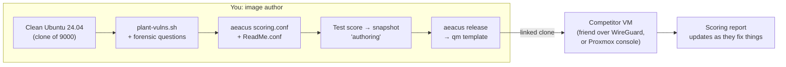

# Project 04: CyberPatriot-Style Linux Image Builder

> Learn Linux hardening twice: first by **securing** a box against a baseline, then by
> **building** your own CyberPatriot-style practice image with planted vulnerabilities, forensic
> questions and an automatic scoring engine ([aeacus](https://github.com/elysium-suite/aeacus)).
> Then swap images with friends and race each other.

## 1. Goal & career relevance

Building a scored image means you have to understand each vulnerability well enough to plant
it, detect it and verify it's fixed. That's three times deeper than following a checklist. It's
also the same skill set as **configuration compliance** work (CIS benchmarks, audit scripts) in
security engineering and GRC, and the realistic foothold/privesc paths pentesters exploit.

**Hiring skills proved:** Linux administration and hardening, CIS benchmarks, users and PAM,
services, file permissions, SUID/privesc, cron persistence, writing audit checks, C basics.

## 2. Concepts covered

- Users, groups, `sudo`/sudoers, UID 0, `/etc/passwd` vs. `/etc/shadow`
- PAM and password policy (`login.defs`, `pam_pwquality`, `nullok`)
- Services with systemd; attack surface reduction
- Firewall (UFW), SSH hardening, Apache basics
- File permissions, SUID/SGID, world-writable files, `PATH` hijacking
- Persistence: cron, shell profiles, hidden files
- Kernel parameters with `sysctl`
- Compliance as code: turning a baseline into automated checks

### Learn alongside (read / watch)

| Resource | Why | Time |
|---|---|---|
| [Linux Journey](https://linuxjourney.com/): "Permissions", "User Management", "Processes", "Init" | Clean, short lessons on exactly these topics | 3 h |
| [OverTheWire Bandit](https://overthewire.org/wargames/bandit/) levels 0–20 | Linux command fluency under pressure, like competition day | 4 h |
| [MIT 6.858](https://ocw.mit.edu/courses/6-858-computer-systems-security-fall-2014/) Lecture 4 "Privilege Separation" + Lecture 5 "OS Security / Capabilities" | Why Unix permissions are designed this way | 2.5 h |
| [MIT Missing Semester](https://missing.csail.mit.edu/) "Command-line Environment" | Job control, dotfiles, aliases (and how attackers abuse them) | 1 h |
| [CIS Ubuntu Linux 24.04 Benchmark](https://www.cisecurity.org/benchmark/ubuntu_linux) (free PDF with registration) | The professional baseline your checklist maps to | skim 1 h |
| [madaidan's Linux Hardening Guide](https://madaidans-insecurities.github.io/guides/linux-hardening.html) | Deep explanations of sysctl, PAM and kernel hardening | optional |
| [CyberPatriot training materials](https://www.uscyberpatriot.org/competition/training-materials) | The official modules (Linux and Windows) | 2 h |
| [GTFOBins](https://gtfobins.github.io/) | How SUID/sudo misconfigurations become root, i.e. why you remove them | browse |
| [CS50x](https://cs50.harvard.edu/x/) weeks 1–2 (C) | For the C exercise | 4 h |

## 3. Estimated time

**10 hours.** 2 h hardening a clean box + baseline doc, 4 h building and scoring the image,
2 h solving a friend's image (or your own, timed), 2 h docs.

## 4. Resources & profile

**Profile A.** cp-linux (VMID 310) on TARGETS, `10.10.30.40`, **2 GB** RAM (Xfce desktop
optional), 25 GB thin disk. A friend's copy is a linked clone (VMID 318–319, temporary) at about
1 GB of real disk.

## 5. Prerequisites

- [ ] Project 01 template 9000 and TEMP egress routine
- [ ] Project 02 done (you're comfortable with tcpdump/ss)
- [ ] A friend willing to swap images (or plan to solve your own after a week off)

## 6. Architecture



## 7. Build steps

### Part A: Harden a clean box first (2 h)

You can't plant what you can't fix. Clone a clean VM and harden it against a short baseline:

```bash
qm clone 9000 310 --name cp-linux
qm set 310 --net0 virtio,bridge=vmbr1,tag=30 --ipconfig0 ip=10.10.30.40/24,gw=10.10.30.1 \
  --nameserver 10.10.30.1 --memory 2048 --balloon 1024
qm disk resize 310 scsi0 25G && qm start 310
```

Create your **hardening baseline** (`scripts/new-doc.sh 04-cyberpatriot-linux-image
hardening-baseline`) with at least 20 controls. Start with these categories and look up the
matching CIS section for each:

| Category | Example controls (check → fix) |
|---|---|
| Accounts | Only authorized users exist (`getent passwd` UID ≥ 1000); no UID 0 except root (`awk -F: '$3==0' /etc/passwd`); no empty passwords (`sudo awk -F: '$2==""' /etc/shadow`); sudo group membership correct (`getent group sudo`) |
| Passwords | `PASS_MAX_DAYS 90`, `PASS_MIN_DAYS 1`, `PASS_WARN_AGE 7` in `/etc/login.defs`; `pam_pwquality` minlen ≥ 12; no `nullok` in `/etc/pam.d/common-auth` |
| Sudo | No `NOPASSWD` (`sudo grep -r NOPASSWD /etc/sudoers /etc/sudoers.d`) |
| SSH | `PermitRootLogin no`, `PasswordAuthentication` as required, check `/etc/ssh/sshd_config.d/` overrides; `sudo sshd -T \| grep -i permitroot` shows the effective value |
| Firewall | `ufw default deny incoming`, allow only required services, `ufw enable` |
| Services | `systemctl list-units --type=service --state=running`; remove what isn't needed |
| Software | No hacking tools/games (`apt list --installed`); updates on (`/etc/apt/apt.conf.d/20auto-upgrades`) |
| Files | No unexpected SUID (`find / -perm -4000 -type f 2>/dev/null`); `/etc/shadow` not world-readable; no world-writable files in `/etc` |
| Persistence | Review `/etc/cron*`, `crontab -l -u <each user>`, `/etc/rc.local`, `~/.bashrc`, `/etc/profile.d/`, systemd units in `/etc/systemd/system` |
| Kernel | `sysctl net.ipv4.tcp_syncookies=1`, `net.ipv4.ip_forward=0` (unless routing), `kernel.randomize_va_space=2` |
| Logging | `auditd` installed; `/var/log/auth.log` present and rotating |

Run [Lynis](https://cisofy.com/lynis/) (`sudo apt install lynis && sudo lynis audit system`;
TEMP egress on) before and after. Record the **hardening index** both times. That's a
measurable resume number.

### Part B: Build the vulnerable image (3 h)

1. **Roll back** to a clean state: `qm rollback`, or destroy and re-clone 310.
2. (Optional, more realistic) add a light desktop with TEMP egress on:
   `sudo apt install -y xubuntu-core` (~1 GB RAM extra), then use the Proxmox console (noVNC).
3. Design your scenario on paper first: a short company story, **authorized users and admins**,
   **critical services** (e.g. SSH and Apache must stay up), and **15–25 vulnerabilities** across
   all baseline categories. Use the design table in `deliverables/` (image design doc). Each
   vuln needs: how you plant it → how the competitor finds it → how aeacus checks it.
4. Write your planting script. Bash is perfect: every vuln is a few commands. Rules:
   - The script must be **idempotent** (running it twice doesn't break anything).
   - Plant **noise** too: harmless files and users that *are* authorized, so competitors have
     to read the README carefully. Real images punish deleting authorized things.
   - Include at least one **persistence** mechanism (cron/systemd/profile backdoor) and one
     **hidden** account or file.
   - Include your C program from the coding exercise (a vulnerable SUID binary).
5. **Forensic questions:** put 2–3 files on the main user's Desktop:
   ```
   Forensic Question 1.txt
   ----
   A hidden account with root privileges exists on this system. What is its username?
   ANSWER:
   ```
   Good questions make competitors investigate (decode base64, find a file by hash, identify the
   port a backdoor uses, find who added a cron job).
6. Snapshot: `qm snapshot 310 planted`.

### Part C: Score it with aeacus (2 h)

1. TEMP egress on → download the Linux release from
   [aeacus releases](https://github.com/elysium-suite/aeacus/releases) and extract it to
   `/opt/aeacus` → TEMP egress off.
2. Write `/opt/aeacus/scoring.conf` (TOML). Start from
   [the check reference](https://github.com/elysium-suite/aeacus/blob/master/docs/checks.md). Key ideas:
   - Prefer native checks (`UserExists`, `PathExists`, `FileContains`, `PermissionIs`,
     `ServiceUp`, `FirewallUp`, `ProgramInstalled`) over `Command*` checks, which competitors
     can tamper with.
   - Append **`Not`** to invert any check (`UserExistsNot`).
   - `pass` conditions are AND, `passoverride` is OR, and any `fail` condition fails the check.
   - A check that *errors* never passes (e.g. `FileContains` on a deleted file). Add a
     `passoverride` with `PathExistsNot` when deleting the file is also a valid fix.
   - **Negative points = penalty** (e.g. deleting an authorized admin or stopping a critical service).
3. Write `/opt/aeacus/ReadMe.conf` (HTML fragment): scenario, authorized admins with
   passwords, authorized users, critical services, special instructions.
4. Iterate:
   ```bash
   cd /opt/aeacus
   sudo ./aeacus --verbose check     # config syntax
   sudo ./aeacus --verbose score     # should show ~0 points on the planted image
   sudo ./aeacus --verbose readme    # builds assets/ReadMe.html
   ```
   Then **fix each vuln yourself** in a scratch snapshot and confirm the score climbs one check at
   a time. A check that never passes, or passes without the fix, is a bug in your image.
5. **Back up `scoring.conf` and `ReadMe.conf` off the VM** (store them in this repo's
   `automation/`-style folder in your *private* copy; they're the answer key).
6. Release: `qm rollback 310 planted` → reinstall aeacus with your config → `sudo ./aeacus
   --verbose release`. It deletes the plaintext config and prepares the image; read
   `./aeacus --help` for what your version does exactly. Shut down → `qm template 310`.

### Part D: Competition (2 h, with a friend)

1. `qm clone 310 319 --name cp-linux-<friend>` (linked clone). Give your friend console access
   (a Proxmox user with *PVEVMUser* on VM 319 only), or SSH over WireGuard.
2. They read the README, then have **2 hours** to maximize their score. You do the same on
   their image.
3. Afterwards: compare scores, walk through each other's answer keys, write an **after-action
   report**. What did you miss? Which vulns were unfair or broken?

## 8. Checkpoints

- [ ] Lynis hardening index recorded before/after Part A
- [ ] Baseline with ≥ 20 controls, each with check + fix commands
- [ ] Image has 15–25 scored vulns, ≥ 2 penalties, 2–3 forensic questions
- [ ] Every check verified to flip from fail → pass when fixed
- [ ] Released template; one competition round played

## 9. Exercises

1. For 5 of your vulns, write how an attacker would *exploit* it (e.g. SUID copy of bash →
   `/usr/local/bin/.sysd -p` → root shell). Hardening makes much more sense once you've seen
   the exploit.
2. Why is `FileContains`-based scoring of `sshd_config` incomplete? (Includes in
   `sshd_config.d/` can override it. `sshd -T` shows the effective config.) Improve one check.
3. A competitor deletes `/etc/sudoers.d/` entirely to "fix" NOPASSWD. What breaks? How would
   you score that as a penalty?
4. Map 10 of your vulns to CIS control numbers and MITRE ATT&CK techniques (e.g. cron backdoor
   → T1053.003).

## 10. Coding exercises

**Before you start:** [Python primer](../../docs/python-primer.md) sections 1, 5 and 7.

**Python: write your own mini scoring engine.** Write `linux_audit.py` that checks 8–10
baseline controls *without* aeacus (UID-0 accounts, empty passwords, sudo group members against
an allowlist, `PermitRootLogin` via `sshd -T`, UFW status, unexpected SUID files against an
allowlist, `PASS_MAX_DAYS`, `nullok`) and prints a PASS/FAIL table with a score. This is exactly
what compliance tools do. Solution: `automation/python/linux_audit.py`.

**C: a SUID program done wrong, then done right.** A classic image vuln is a "backup helper" a
sysadmin made SUID-root so users could run backups. It calls `system()` with a *relative*
`tar`, so the shell resolves it through the caller's `PATH`.
1. Write that short program yourself in C on **cp-linux only**, make it SUID root, and plant it
   (this is item 14 in the answer key). Read `man 3 system` and explain in your WORKLOG *why*
   a relative command name in a SUID program is dangerous. [GTFOBins](https://gtfobins.github.io/)
   and the PATH section of `man 7 environ` explain the mechanism.
2. Confirm your aeacus check flips to PASS once the SUID bit is removed.
3. Write the **fixed** version: absolute path, `execve` instead of `system`, a fixed
   environment, output to a root-owned directory, and a comment on why *not being SUID at all*
   is usually best.
- Learn first: [CS50x](https://cs50.harvard.edu/x/) weeks 1–2 (C basics), `man 2 execve`,
  `man 7 credentials`, [MIT 6.858 Lecture 4](https://ocw.mit.edu/courses/6-858-computer-systems-security-fall-2014/) (privilege separation).
- Solution: `automation/c/backup_helper_fixed.c` (`make`); the flaw is explained in
  `automation/answer-key.md`.

## 11. Snapshot / teardown

- Keep the template (310) and `planted` snapshot. P10 (red vs. blue) clones these.
- Destroy friends' clones after the round (`qm destroy 319`).

## 12. Stretch goals

- **Remote scoring:** run [sarpedon](https://github.com/elysium-suite/sarpedon) (aeacus's
  scoreboard) in Docker on LAB-MGMT so multiple images report to one live leaderboard.
- Build a **Linux Mint** or **Debian** variant (CyberPatriot uses several distros).
- Hide a vuln in a **systemd timer** or a **PAM module** line (`pam_exec.so`), which is harder to
  find.
- Write an **Ansible playbook** that applies your hardening baseline (bridges to P13).

## 13. Documentation deliverables

| Deliverable | Template |
|---|---|
| Hardening baseline (≥ 20 controls, CIS-mapped) | `hardening-baseline` (suffix `ubuntu`) |
| Image design doc: scenario, vuln table (plant / find / check / points), forensic Qs | `runbook-sop` (suffix `image-build`), with the vuln table |
| Answer key (private, don't publish if you'll reuse the image) | in the image design doc appendix |
| After-action report of the competition round | `after-action-report` (suffix `cp-round1`) |

## 14. Definition of done

- [ ] Checkpoints ticked; Lynis before/after numbers in WORKLOG
- [ ] Baseline, image design doc and AAR written
- [ ] Python audit tool and C exercise done (flaw explained **and** fixed version built)
- [ ] Resume bullet + path-finder rating

## 15. Resume bullets

- *Built a CyberPatriot-style Ubuntu practice image with 20+ planted vulnerabilities, forensic
  questions and automated scoring (aeacus); ran timed competitions with peers.*
- *Authored a 25-control Linux hardening baseline mapped to CIS benchmarks; raised the Lynis
  hardening index from <X> to <Y>.*
- *Wrote a Python compliance auditor and remediated a SUID PATH-hijacking flaw by rewriting a
  C helper with `execve`, absolute paths and a sanitized environment.*

## 16. References

- [aeacus](https://github.com/elysium-suite/aeacus): [checks](https://github.com/elysium-suite/aeacus/blob/master/docs/checks.md),
  [config](https://github.com/elysium-suite/aeacus/blob/master/docs/config.md),
  [examples](https://github.com/elysium-suite/aeacus/tree/master/docs/examples)
- [troy-cyber/scorpio](https://github.com/troy-cyber/scorpio): an alternative Ubuntu scoring engine
- [CIS Benchmarks](https://www.cisecurity.org/cis-benchmarks) · [Lynis](https://github.com/CISOfy/lynis)
- [Ubuntu Server security docs](https://documentation.ubuntu.com/server/explanation/security/)
- [MITRE ATT&CK: Scheduled Task/Job: Cron (T1053.003)](https://attack.mitre.org/techniques/T1053/003/)
