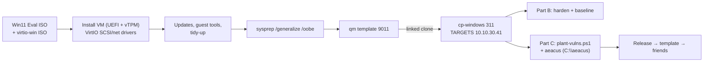

# Project 05: CyberPatriot-Style Windows Image Builder

> Do for Windows what Project 04 did for Linux: harden a clean Windows 11 box, then build a
> scored practice image (local security policy, audit policy, users, services, shares,
> registry, Defender) using aeacus. Along the way you'll build the **Windows templates**
> Project 07 (Active Directory) needs.

## 1. Goal & career relevance

Most corporate endpoints run Windows, and most real intrusions involve Windows hosts. Knowing
where Windows keeps its security settings (secpol, auditpol, registry, services, Defender) is
expected of SOC analysts, sysadmins, security engineers and pentesters alike. PowerShell is
listed in many postings alongside Python.

**Hiring skills proved:** Windows administration and hardening, local security policy, audit
policy, PowerShell, CIS Windows benchmarks, virtualization (UEFI/TPM VMs, VirtIO drivers).

## 2. Concepts covered

- Local users and groups, built-in accounts (Administrator, Guest), UAC
- Account policies: password and lockout (`secpol.msc`, `net accounts`)
- Audit policy (`auditpol`) and the Security event log, the foundation for P08
- Security Options (registry-backed policies: LM hashes, anonymous enumeration, SMB signing)
- Services, scheduled tasks, Run keys (common persistence locations)
- Windows Firewall profiles, RDP and NLA, SMBv1, file shares and NTFS permissions
- Microsoft Defender settings (exclusions are a favorite attacker trick)
- Building Windows VMs on Proxmox: OVMF/UEFI, vTPM, VirtIO, sysprep, templates

### Learn alongside (read / watch)

| Resource | Why | Time |
|---|---|---|
| [Microsoft Learn: PowerShell 101](https://learn.microsoft.com/en-us/powershell/scripting/learn/ps101/00-introduction) | You'll script everything in PowerShell | 3 h |
| [Microsoft: Security policy settings reference](https://learn.microsoft.com/en-us/previous-versions/windows/it-pro/windows-10/security/threat-protection/security-policy-settings/security-policy-settings) | What every secpol option means | browse |
| [Microsoft: Advanced security audit policy](https://learn.microsoft.com/en-us/previous-versions/windows/it-pro/windows-10/security/threat-protection/auditing/advanced-security-audit-policy-settings) | Which events you'll hunt for in P08 | 1 h |
| [CIS Microsoft Windows 11 Enterprise Benchmark](https://www.cisecurity.org/benchmark/microsoft_windows_desktop) (free PDF with registration) | Professional baseline for your checklist | skim 1 h |
| [CyberPatriot training materials](https://www.uscyberpatriot.org/competition/training-materials) (Windows modules) | Competition-style checklist | 2 h |
| [MIT 6.858](https://ocw.mit.edu/courses/6-858-computer-systems-security-fall-2014/) Lecture on capabilities/sandboxing | Why least privilege and UAC exist | 1.5 h |
| 13Cubed (YouTube): "Windows Registry" and "Persistence" episodes | Where attackers hide on Windows | 1 h |
| [Proxmox wiki: Windows 11 guest best practices](https://pve.proxmox.com/wiki/Windows_11_guest_best_practices) | Getting the VM itself right | 30 min |

## 3. Estimated time

**10 hours.** 3 h building Windows templates (mostly waiting on installs), 2 h hardening and
baseline, 3 h building and scoring the image, 2 h docs/competition.

## 4. Resources & profile

| VM | Segment | RAM | Disk (thin) |
|---|---|---|---|
| tpl-win11 (9011) | — (template) | — | 64 GB (~20 GB used) |
| tpl-winserver-2022 (9010) | — (template, used in P07) | — | 50 GB (~15 GB used) |
| cp-windows (311) | TARGETS `10.10.30.41` | **4 GB** | linked clone of 9011 |

Windows 11 needs about 4 GB to be pleasant. Stop other lab VMs; prod-ubuntu can usually stay on.
KSM will merge pages when several Windows VMs run together later.
*Two nodes?* Put Windows templates on node 2.

## 5. Prerequisites

- [ ] Project 04 done (you know the image-building flow and aeacus)
- [ ] Download on your laptop and upload to Proxmox (*local → ISO Images → Upload*):
  - Windows 11 Enterprise **Evaluation** ISO and Windows Server 2022 **Evaluation** ISO
    from the [Microsoft Evaluation Center](https://www.microsoft.com/evalcenter)
  - the latest stable [virtio-win ISO](https://pve.proxmox.com/wiki/Windows_VirtIO_Drivers)
- [ ] TEMP egress rule on TARGETS ready (for Windows activation / updates during the build)

## 6. Architecture



## 7. Build steps

### Part A: Windows templates (3 h, mostly waiting)

Do Windows 11 first; repeat for Server 2022 (Project 07 uses it).

1. Create the VM (GUI: *Create VM*, or `automation/create-windows-vm.sh`):
   - OS: Microsoft Windows 11/2022, ISO = Windows ISO; **add a second CD drive** with virtio-win
   - System: machine **q35**, BIOS **OVMF (UEFI)**, add **EFI disk**, add **TPM v2.0**, ☑ Qemu agent
   - Disk: **SCSI**, controller **VirtIO SCSI single**, 64 GB, ☑ Discard, ☑ IO thread
   - CPU: type **host**, 2 cores. Memory: 4096 MiB
   - Network: **VirtIO**, bridge `vmbr1`, **VLAN tag 30**
2. Install: at disk selection Windows sees no disk. Click *Load driver* → virtio CD →
   `vioscsi\w11\amd64` (Server: `vioscsi\2k22\amd64`). Also load `NetKVM` so the network works.
3. Windows 11 setup insists on a Microsoft account and internet. Choose "I don't have
   internet" if offered, or press **Shift+F10** and run `start ms-cxh:localonly` (newer builds)
   to create a **local account**. Methods change between builds; search the current one.
4. After first login: run `virtio-win-guest-tools.exe` from the virtio CD (drivers + QEMU guest
   agent + balloon). Enable TEMP egress → Windows Update → disable TEMP egress.
5. **Snapshot**, then generalize:
   ```powershell
   C:\Windows\System32\Sysprep\sysprep.exe /generalize /oobe /shutdown
   ```
   When it powers off: `qm template 9011`. Never boot the template again; clone it.

> Sysprep fails on Windows 11 if Store apps were updated for one user only. The fix is in
> `C:\Windows\System32\Sysprep\Panther\setupact.log`. Find the package name, then
> `Remove-AppxPackage` it. Write it in your WORKLOG; it happens to everyone.

### Part B: Harden a clean clone + baseline (2 h)

```bash
qm clone 9011 311 --name cp-windows && qm start 311
```
Finish OOBE, set static IP `10.10.30.41/24`, gateway `10.10.30.1`, DNS `10.10.30.1`.

Write a **Windows hardening baseline** (≥ 20 controls) by working through each area *by hand*
first (GUI), then finding the PowerShell or `cmd` equivalent:

| Area | Where (GUI) | Command to check |
|---|---|---|
| Users/groups | `lusrmgr.msc` | `Get-LocalUser`, `Get-LocalGroupMember Administrators` |
| Password & lockout policy | `secpol.msc` → Account Policies | `net accounts` |
| Audit policy | `secpol.msc` → Advanced Audit Policy | `auditpol /get /category:*` |
| Security Options | `secpol.msc` → Local Policies → Security Options | `secedit /export /cfg C:\sec.inf` then read it |
| Firewall | `wf.msc` | `Get-NetFirewallProfile \| ft Name,Enabled,DefaultInboundAction` |
| Services | `services.msc` | `Get-Service \| ? Status -eq Running` |
| Persistence | Task Scheduler, Registry Run keys | `Get-ScheduledTask`, `Get-ItemProperty HKLM:\Software\Microsoft\Windows\CurrentVersion\Run` |
| Shares | `fsmgmt.msc` | `Get-SmbShare` |
| Remote access | System Properties → Remote | `Get-ItemProperty 'HKLM:\System\CurrentControlSet\Control\Terminal Server'` |
| SMBv1 | Windows Features | `Get-WindowsOptionalFeature -Online -FeatureName SMB1Protocol` |
| Defender | Windows Security app | `Get-MpPreference \| select Exclusion*, DisableRealtimeMonitoring` |
| UAC | `secpol.msc` | `Get-ItemProperty HKLM:\Software\Microsoft\Windows\CurrentVersion\Policies\System` |

Snapshot `hardened-reference`. You'll compare against it when designing vulns.

### Part C: Build and score the vulnerable image (3 h)

1. Roll back to a clean clone (or re-clone 9011 → 311).
2. Design the scenario and 15–25 vulns across the areas above, plus 2–3 forensic questions
   (e.g. "What user created the scheduled task *Updater*?", "What folder is excluded from
   Defender scanning?"). Include **noise**: authorized users and services that look suspicious
   but must stay.
3. Write a PowerShell planting script. Run it from an **elevated** PowerShell with
   `Set-ExecutionPolicy -Scope Process Bypass`. Make every persistence item **inert** (it should
   just write a file or run `cmd /c exit`). The competitor's job is to find it, not to be harmed by it.
4. TEMP egress on → download the aeacus **Windows** release → extract to `C:\aeacus` → TEMP egress off.
5. Write `C:\aeacus\scoring.conf`. Windows-specific checks to use:
   - `SecurityPolicy` (keys like `MinimumPasswordLength`, `LockoutBadCount`, `EnableGuestAccount`,
     `AuditLogonEvents`; see aeacus `docs/securitypolicy.md`)
   - `RegistryKey` / `RegistryKeyExists` for anything else
   - `UserDetail` (`IsEnabled`, `PasswordNeverExpires`…), `UserInGroup`, `ServiceUp`,
     `ServiceStartup`, `ShareExists`, `ScheduledTaskExists`, `WindowsFeature`, `FirewallUp`
   - Use TOML **single-quoted** strings for Windows paths (`'C:\Users\Public'`), so no escaping
6. `.\aeacus.exe --verbose check`, `score`, `readme`. Fix each vuln in a scratch snapshot and
   confirm the score climbs. Back up `scoring.conf` off the VM. `release`, shut down, `qm
   template 311`, and run a competition round like in P04.

## 8. Checkpoints

- [ ] Templates 9011 (Win11) and 9010 (Server 2022) exist and clone cleanly
- [ ] Hardening baseline ≥ 20 controls with GUI location **and** command
- [ ] Image with 15–25 scored vulns, ≥ 2 penalties, 2–3 forensic questions, all verified
- [ ] One competition round played and the AAR written

## 9. Exercises

1. Turn on *Audit Logon* (success + failure), then fail a login 3 times. Find event **4625**
   in Event Viewer. Which fields tell you the source and logon type? (P08 builds detections on this.)
2. Explain why a Defender **exclusion** is more dangerous than turning Defender off. (Quieter:
   the UI still says "protected".)
3. Find 5 persistence locations attackers use on Windows (MITRE T1547, T1053, T1543) and
   check each on your image.
4. Compare `net accounts` before and after joining a domain in P07. Where does the policy
   come from now?

## 10. Coding exercises

**Before you start:** [Python primer](../../docs/python-primer.md) sections 1 and 3, and
[PowerShell 101](https://learn.microsoft.com/en-us/powershell/scripting/learn/ps101/00-introduction).

**PowerShell: an audit script.** Write `Audit-Windows.ps1` that checks 10 baseline controls and
outputs objects (`[pscustomobject]@{Id=..; Control=..; Result=..; Detail=..}`), then
`| Export-Csv audit.csv` and `| ConvertTo-Json`. Objects instead of text is *the* PowerShell
idea, so learn it here. Solution: `automation/Audit-Windows.ps1`.

**Python: diff two audits.** Write `compare_audits.py` that loads two of those JSON files
(before/after) and prints which controls changed from FAIL to PASS, and which regressed. It's a
tiny version of what compliance dashboards do. Solution: `automation/python/compare_audits.py`.

## 11. Snapshot / teardown

- Keep templates 9010/9011 (P07 needs them) and the released cp-windows template.
- Evaluation licenses expire (Win11: 90 days, Server: 180 days). Rebuilding from the ISO is
  practice for P13's automation.

## 12. Stretch goals

- Apply Microsoft's **Security Baseline** GPOs with LGPO.exe (Microsoft Security Compliance
  Toolkit) and compare against your own baseline.
- Score **BitLocker** (`BitlockerEnabled` check). The vTPM makes this possible.
- Add a vulnerable **IIS** site as a critical service.

## 13. Documentation deliverables

| Deliverable | Template |
|---|---|
| Windows hardening baseline (≥ 20 controls, GUI + command, CIS-mapped) | `hardening-baseline` (suffix `windows11`) |
| Windows template build runbook (UEFI/TPM/VirtIO/sysprep) | `runbook-sop` (suffix `windows-template`) |
| Image design doc + answer key (private) | `runbook-sop` (suffix `image-build`) |
| After-action report of the round | `after-action-report` (suffix `cp-win-round1`) |

## 14. Definition of done

- [ ] Checkpoints ticked
- [ ] Baseline, runbook, design doc and AAR written
- [ ] PowerShell audit + Python diff working
- [ ] Resume bullet + path-finder rating

## 15. Resume bullets

- *Built Windows 11 and Server 2022 golden images on Proxmox (UEFI, vTPM, VirtIO, sysprep) and a
  scored CyberPatriot-style Windows practice image covering local security policy, audit policy,
  services, shares, registry and Defender misconfigurations.*
- *Authored a 25-control Windows hardening baseline with PowerShell audit automation exporting
  CSV/JSON compliance reports.*

## 16. References

- [aeacus](https://github.com/elysium-suite/aeacus): [checks](https://github.com/elysium-suite/aeacus/blob/master/docs/checks.md) ·
  [security policy keys](https://github.com/elysium-suite/aeacus/blob/master/docs/securitypolicy.md) ·
  [user properties](https://github.com/elysium-suite/aeacus/blob/master/docs/userproperties.md)
- [Proxmox: Windows VirtIO drivers](https://pve.proxmox.com/wiki/Windows_VirtIO_Drivers)
- [Microsoft: Sysprep overview](https://learn.microsoft.com/en-us/windows-hardware/manufacture/desktop/sysprep--generalize--a-windows-installation)
- [Microsoft Security Compliance Toolkit](https://www.microsoft.com/en-us/download/details.aspx?id=55319)
- MITRE ATT&CK: [T1547 Boot or Logon Autostart](https://attack.mitre.org/techniques/T1547/) ·
  [T1562.001 Impair Defenses](https://attack.mitre.org/techniques/T1562/001/)
