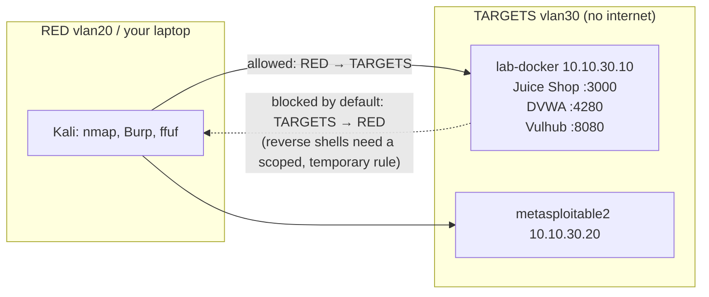

# Project 06: Web & Network Penetration Testing

> Run scoped penetration tests against intentionally vulnerable targets in your lab: OWASP
> Juice Shop and DVWA (part 1, web), then Metasploitable 2 and Vulhub (part 2, network). Then
> write a **professional pentest report**, which is the actual product pentesters deliver.

## 1. Goal & career relevance

Offensive skills make you a better defender, and a well-written report is the deliverable that
matters most in a pentest. Interns are rarely asked to find zero-days. They're asked to follow a
methodology, use standard tools correctly, stay in scope, and **communicate findings clearly**.

**Hiring skills proved:** recon/enumeration (Nmap), web app testing (Burp Suite, OWASP Top 10),
vulnerability validation, privilege escalation basics, CVSS scoring, professional reporting.

## 2. Concepts covered

- Methodology: scoping and rules of engagement, recon → enumeration → vuln identification →
  exploitation → post-exploitation → reporting (PTES, OWASP WSTG, NIST SP 800-115)
- HTTP deeply: methods, headers, cookies, sessions, same-origin policy
- OWASP Top 10: broken access control, injection (SQLi, command injection), XSS, auth
  failures, security misconfiguration, vulnerable components
- Intercepting proxies (Burp Suite Community)
- Service enumeration, default credentials, outdated services, Linux privesc basics
- Egress filtering and why reverse shells need firewall holes (ties back to P01)
- CVSS v3.1 scoring and writing remediation advice

### Learn alongside (read / watch)

| Resource | Why | Time |
|---|---|---|
| [PortSwigger Web Security Academy](https://portswigger.net/web-security): SQL injection, XSS, access control, authentication learning paths | The best free web-security training, with labs | 8 h+ |
| [Stanford CS 253 Web Security](https://web.stanford.edu/class/cs253/) lectures 1–6 | How browsers and the web security model actually work | 6 h |
| [MIT 6.858](https://ocw.mit.edu/courses/6-858-computer-systems-security-fall-2014/) web security lectures (Lecture 8–9) | University view of web attacks | 3 h |
| [OWASP Top 10](https://owasp.org/Top10/) + [OWASP Web Security Testing Guide](https://owasp.org/www-project-web-security-testing-guide/) | The categories your findings map to | 2 h |
| [NIST SP 800-115](https://csrc.nist.gov/pubs/sp/800/115/final) sections 1–4 | How organizations define a security assessment | 1 h |
| IppSec (YouTube), any "Easy" Linux box | Watch a methodical tester think out loud | 2 h |
| [Public pentest report examples](https://github.com/juliocesarfort/public-pentesting-reports) | See what real deliverables look like before writing yours | 1 h |
| [CVSS v3.1 calculator + user guide](https://www.first.org/cvss/calculator/3.1) | Score findings consistently | 30 min |
| LiveOverflow (YouTube): "Binary Exploitation" playlist, first 5 videos | For the C exercise | 2 h |

## 3. Estimated time

**16 hours total.** Part 1 web: 8 h (Phase 1). Part 2 network: 8 h (Phase 3).

## 4. Resources & profile

**Profile A.**

| VM | Segment | RAM | Notes |
|---|---|---|---|
| lab-docker (301) | TARGETS `10.10.30.10` | 3 GB | Juice Shop :3000, DVWA :4280, one Vulhub env at a time |
| metasploitable2 (302) | TARGETS `10.10.30.20` | 512 MB | Part 2 only. Deliberately ancient; never give it internet |
| Kali | laptop (preferred) or VM 201 on RED | 0 / 3 GB | Burp Suite, nmap, etc. |

## 5. Prerequisites

- [ ] Projects 01–02 (you can read the traffic you generate)
- [ ] Kali or a Linux box with nmap, Burp Suite Community, gobuster/ffuf, and a browser with
      FoxyProxy. Reachable to TARGETS (RED VLAN, or your laptop via the P01 admin route / P03 VPN)
- [ ] **Write the Rules of Engagement first** (`rules-of-engagement` template): scope =
      `10.10.30.10` ports 3000/4280 for part 1; everything else is out of scope

## 6. Architecture



## 7. Build steps

### Part 1: Web application testing (8 h)

**Step 1: Deploy the targets (30 min).** On lab-docker, use `automation/docker-compose.yml`
(TEMP egress on only while pulling images; P02's install script already pre-pulled them):

```bash
cd ~/targets && docker compose up -d
docker compose ps        # juice-shop on 3000, dvwa on 4280
```
Browse from Kali: `http://10.10.30.10:3000` and `http://10.10.30.10:4280` (DVWA: log in
`admin` / `password`, click *Create / Reset Database*, set *DVWA Security* to **low** first).

**Step 2: Recon and mapping (1 h).**
```bash
nmap -sV -p- 10.10.30.10 -oA recon/lab-docker
```
Configure Burp as a proxy, browse every page of Juice Shop, and look at *Target → Site map*.
Write down every endpoint, parameter, cookie and API route (Juice Shop is a single-page app;
the interesting traffic is the `/rest/` and `/api/` calls).

**Step 3: Find and validate vulnerabilities (5 h).** Work through OWASP Top 10 categories. Juice
Shop has a built-in *Score Board* (finding it is the first challenge) that tracks your
progress. Aim for:

| Category | Juice Shop / DVWA targets to attempt |
|---|---|
| A01 Broken access control | view another user's basket; access the admin section |
| A03 Injection | login bypass via SQL injection; DVWA *SQL Injection* and *Command Injection* (low, then medium) |
| A03 XSS | DOM XSS in search; DVWA reflected and stored XSS |
| A07 Auth failures | weak admin password; password reset logic |
| A05 Misconfiguration | exposed directories/files, verbose errors |
| A06 Vulnerable components | identify outdated libraries from responses |

For every finding, capture: request/response in Burp, screenshot, impact, and **fix**. Then raise
DVWA to *medium* and *high*: why do your payloads stop working? Reading DVWA's *View Source*
for each level teaches more about defenses than almost anything else.

> Use official hints, the [Juice Shop companion guide](https://pwning.owasp-juice.shop/), and
> PortSwigger's matching labs when stuck. Note in your WORKLOG which hints you used.

**Step 4: Write the report (1.5 h).** Use `templates/pentest-report.md`. Minimum: executive
summary, scope, methodology, 6+ findings with CVSS 3.1 vectors, reproduction steps, remediation.
Then write **2 write-ups** (`ctf-writeup` template) of your favorite challenges.

### Part 2: Network testing (8 h)

**Step 5: Metasploitable 2 (1 h setup).** Download it from
[Rapid7's docs page](https://docs.rapid7.com/metasploit/metasploitable-2/) on your laptop,
extract the `.vmdk`, copy it to Proxmox, and import:
```bash
qm create 302 --name metasploitable2 --memory 512 --cores 1 --ostype l26 \
  --net0 e1000,bridge=vmbr1,tag=30
qm importdisk 302 Metasploitable.vmdk local-lvm
qm set 302 --ide0 local-lvm:vm-302-disk-0 --boot order=ide0
qm start 302
```
Log in on the console (`msfadmin`/`msfadmin`) and set a static IP `10.10.30.20` in
`/etc/network/interfaces`. Update your RoE scope to include it.

**Step 6: Enumerate everything (2 h).** `nmap -sC -sV -p- 10.10.30.20`. For each open service,
record: version, default creds?, known vulnerabilities (search exploit-db/`searchsploit` and
NVD), and what an attacker gains. Metasploitable has dozens of issues. Your job is a **complete
inventory**, not just one shell.

**Step 7: Validate the critical ones (3 h).** Pick 4–5 high-impact services and validate them
(Metasploit Framework is fine here; understand what each module does before running it). Many
validations need the target to connect *back* to you. That's blocked by your P01 egress design,
which is a real-world lesson. To allow it in a controlled way, add a **disabled-by-default** rule
on TARGETS: `Pass | TARGETS net → RED net | TCP 4444–4460`, enable it only for the session, and
log it as a change.

**Step 8: Vulhub (1 h).** Vulhub has hundreds of single-CVE environments. Pick one web CVE
(e.g. an Apache Struts, Drupal or Confluence entry), read its README, `docker compose up -d` it on
lab-docker (TEMP egress on to pull), validate it, and document it as one finding.

**Step 9: Report v2 (1 h).** Add the network findings to a second report or an appendix. Rank
everything in a remediation roadmap.

## 8. Checkpoints

- [ ] Signed RoE (yes, even for yourself)
- [ ] Juice Shop score board showing at least 15 solved challenges; DVWA SQLi/XSS/command
      injection done on low **and** medium
- [ ] Pentest report v1 (web) with 6+ CVSS-scored findings and 2 write-ups
- [ ] Metasploitable service inventory + 4–5 validated findings; report v2
- [ ] Reverse-connection firewall rule disabled again

## 9. Exercises

1. For each finding, write the **defender's view**: what log line or alert would have caught it?
   (Bridges to P08.)
2. Explain parameterized queries vs. string concatenation with a 5-line example in Python
   (see [Python primer §13](../../docs/python-primer.md#13-databases-sqlite3)).
3. Why does DVWA *high* defeat your *low* payloads? Read the source and explain each defense.
4. Score the same SQL injection finding with CVSS twice: once as unauthenticated over the
   internet, once as authenticated on an internal network. Explain the difference to a manager.

## 10. Coding exercises

**Before you start:** [Python primer](../../docs/python-primer.md) sections 9 and 10.

**Python: HTTP security header auditor.** Write `header_audit.py` that requests a list of URLs
and reports missing or weak security headers (`Content-Security-Policy`,
`Strict-Transport-Security`, `X-Content-Type-Options`, `X-Frame-Options`/`frame-ancestors`,
`Referrer-Policy`) and cookie flags (`Secure`, `HttpOnly`, `SameSite`), with a severity for
each. Run it against Juice Shop and DVWA, then paste its output into your report as a
"Security misconfiguration" finding. Solution: `automation/python/header_audit.py`.

**C: observe a stack buffer overflow, then fix it.** Compile `automation/c/overflow_demo.c`, a
tiny program that copies input into a fixed-size buffer with an unsafe function:
1. Build it twice: with protections (`make protected`) and without the stack canary
   (`make unprotected`). Feed it a long input and compare the crashes: `*** stack smashing
   detected ***` vs. a segmentation fault.
2. In GDB (`gdb ./overflow_unprotected`, `run`, then `info registers rip` and `x/8gx $rsp`),
   find your input bytes overwriting the saved return address. Draw the stack frame in your
   WORKLOG.
3. Run `checksec` (or `readelf -l` / `readelf -s`) on both builds and explain each protection:
   **stack canary, NX, PIE, ASLR, RELRO**.
4. Fix the code with a bounded copy (`snprintf`/`strncpy` with explicit termination, or
   `fgets`) and show the long input no longer crashes it.
- Want to go further into *exploitation*? That's exactly what [pwn.college](https://pwn.college/)
  "Program Security" and [Nightmare](https://guyinatuxedo.github.io/) teach, in purpose-built
  environments.
- Learn first: [CS50x](https://cs50.harvard.edu/x/) week 4 (memory),
  [MIT 6.858 Lecture 2–3](https://ocw.mit.edu/courses/6-858-computer-systems-security-fall-2014/) (buffer overflows).

## 11. Snapshot / teardown

- `docker compose down` when not testing (Juice Shop + DVWA use about 600 MB).
- Shut down metasploitable2 when finished; **never** attach it anywhere but TARGETS.
- Disable the TARGETS → RED reverse-connection rule.

## 12. Stretch goals

- Finish Juice Shop's 3–4 star challenges, or try **WebGoat** and **crAPI** (API security).
- Do 5 [PortSwigger](https://portswigger.net/web-security) Apprentice labs per category and
  prepare for the **BSCP** later.
- Linux privilege escalation on Metasploitable from a low-privilege shell: run LinPEAS and
  explain each finding against [GTFOBins](https://gtfobins.github.io/).
- Retire an "Easy" HTB/TryHackMe box per week and write it up (only retired boxes; respect
  platform rules).

## 13. Documentation deliverables

| Deliverable | Template |
|---|---|
| Rules of engagement (scope for part 1 and part 2) | `rules-of-engagement` |
| Pentest report v1: web (exec summary, CVSS findings, remediation) | `pentest-report` (suffix `web`) |
| Pentest report v2: network (or appendix) | `pentest-report` (suffix `network`) |
| ≥ 2 write-ups | `ctf-writeup` (suffix per challenge) |

## 14. Definition of done

- [ ] Checkpoints ticked
- [ ] Reports reviewed by someone else (a friend, a club member, a professor): did they understand the exec summary?
- [ ] Python and C exercises done
- [ ] Resume bullet + path-finder rating

## 15. Resume bullets

- *Performed grey-box web application penetration tests against OWASP Juice Shop and DVWA
  following OWASP WSTG; documented 8 findings with CVSS 3.1 scores and remediation guidance in
  a professional report.*
- *Enumerated and validated critical vulnerabilities on a deliberately vulnerable Linux host
  under written rules of engagement; produced a prioritized remediation roadmap.*
- *Built a Python HTTP security-header auditor used to document misconfiguration findings.*

## 16. References

- [OWASP Juice Shop](https://github.com/juice-shop/juice-shop) · [companion guide](https://pwning.owasp-juice.shop/)
- [DVWA](https://github.com/digininja/DVWA)
- [Vulhub](https://github.com/vulhub/vulhub)
- [Metasploitable 2 guide](https://docs.rapid7.com/metasploit/metasploitable-2-exploitability-guide/)
- [PTES technical guidelines](http://www.pentest-standard.org/)
- [HackTricks](https://book.hacktricks.wiki) · [GTFOBins](https://gtfobins.github.io/)
- [CVSS v3.1 specification](https://www.first.org/cvss/v3.1/specification-document)
