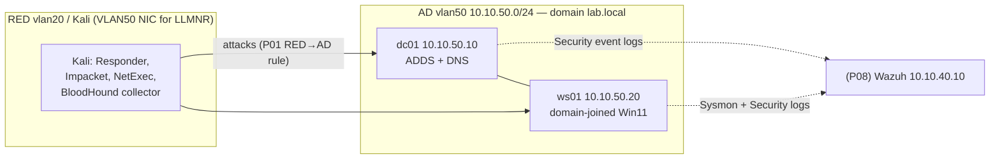

# Project 07: Active Directory — Build, Attack, Defend

> Stand up a small Windows domain, run the classic AD attacks against it from Kali, then fix
> the misconfigurations that made them work. This is the single most resume-relevant project in
> the repo and the backbone of the Project 08 purple-team showcase.

## 1. Goal & career relevance

Almost every company runs Active Directory, and almost every real intrusion abuses it. Being
able to explain Kerberoasting, AS-REP roasting and LLMNR poisoning, and then show how you'd
*detect and prevent* them, is exactly what SOC, pentest and security-engineering interviewers
probe. Doing all three sides (build, attack, defend) is what makes it stick.

## 2. Concepts covered

- AD DS: domains, OUs, users, groups, the role of DNS, Kerberos vs. NTLM
- Service accounts and SPNs; Group Policy (GPO)
- Attacks (in an isolated lab): LLMNR/NBT-NS poisoning, AS-REP roasting, Kerberoasting,
  password spraying, and mapping attack paths with BloodHound
- Defenses: strong/managed service-account passwords, disabling LLMNR and NBT-NS, SMB signing,
  LAPS, tiering, pre-authentication, and auditing the events that reveal each attack

### Learn alongside (read / watch)

| Resource | Why | Time |
|---|---|---|
| [TryHackMe: Active Directory Basics](https://tryhackme.com/room/winadbasics) + "Compromising Active Directory" path | Guided, lab-based intro to everything here | 6 h |
| [Microsoft Learn: AD DS overview](https://learn.microsoft.com/en-us/windows-server/identity/ad-ds/get-started/virtual-dc/active-directory-domain-services-overview) and [Kerberos authentication overview](https://learn.microsoft.com/en-us/windows-server/security/kerberos/kerberos-authentication-overview) | How it's supposed to work before you break it | 2 h |
| Computerphile / VbScrub (YouTube): "Kerberos explained", "Kerberoasting" | Intuition for the ticket dance | 1.5 h |
| [The Hacker Recipes: Active Directory](https://www.thehacker.recipes/ad/) | Reference for each attack and its defense | browse |
| [MIT 6.858](https://ocw.mit.edu/courses/6-858-computer-systems-security-fall-2014/) Kerberos lecture | The protocol from first principles | 1.5 h |
| [BloodHound CE docs](https://bloodhound.specterops.io/) | What the graph is telling you | 1 h |
| [Microsoft: Securing privileged access / tiering](https://learn.microsoft.com/en-us/security/privileged-access-workstations/privileged-access-access-model) | The defensive model you'll apply | 1 h |
| benheater.com GOAD-on-Proxmox series | If you attempt the GOAD-Mini stretch goal | 2 h |

## 3. Estimated time

**18 hours.** Build 6 h, attack 6 h, defend 4 h, docs 2 h. Spread across Phase 2 (winter break).

## 4. Resources & profile

**Profile B. Stop prod-ubuntu**, or run Kali on your laptop to save 2.5 GB.

| VM | Segment | RAM | Notes |
|---|---|---|---|
| dc01 (501) | AD `10.10.50.10` | 2.5 GB (2 GB if Server Core) | Server 2022, domain controller + DNS |
| ws01 (502) | AD `10.10.50.20` | 4 GB | Windows 11, domain-joined workstation |
| Kali | laptop or VM 201 on RED | 0 / 2.5 GB | Impacket, NetExec, Responder |

LLMNR poisoning only works **inside the same broadcast domain**, so for that one exercise give
Kali a NIC in **VLAN 50** (or run it on ws01's segment). Everything else works routed from RED.
*Two nodes?* Put dc01/ws01 on node 2 and run the whole thing while prod stays up.

## 5. Prerequisites

- [ ] Project 05 templates 9010 (Server 2022) and 9011 (Win11)
- [ ] Project 01 RED→AD rule enabled for this project; AD egress TEMP rule for activation/updates
- [ ] Kali with [Impacket](https://github.com/fortra/impacket),
      [NetExec](https://github.com/Pennyw0rth/NetExec) and Responder; BloodHound CE on your laptop
- [ ] **Signed rules of engagement** (your own lab, but practice the habit): scope = the AD
      segment only

## 6. Architecture

## 7. Build steps

### Part A: Build the domain (6 h)

1. Clone dc01 from the Server 2022 template, ws01 from the Win11 template, onto VLAN 50 with
   the static IPs above. dc01's DNS points to itself (`127.0.0.1`); ws01's DNS points to
   `10.10.50.10`.
2. On dc01: rename to `dc01`, then install AD DS and promote to a new forest `lab.local`
   (`automation/01-build-dc.ps1` does this with Server Manager equivalents). Reboot.
3. Create OUs, users and groups (`automation/02-populate-ad.ps1`). The script deliberately
   creates a **realistic but vulnerable** environment, in the spirit of well-known training
   labs. It plants, with explanations:
   - a service account with an **SPN and a weak password** (Kerberoastable)
   - a user with **"Do not require Kerberos preauthentication"** set (AS-REP roastable)
   - a normal user whose **description contains a password** (a real, common mistake)
   - nested group memberships that create an **attack path to Domain Admins** (for BloodHound)
4. Join ws01 to the domain. Log in as a domain user. Confirm DNS and `whoami /groups`.
5. **Snapshot both VMs** as `ad-vulnerable`. This is your attack baseline.

### Part B: Attack it (6 h)

> Everything here uses **standard, publicly documented tools** against **your own isolated
> lab**. Keep it in VLAN 50. The point is to understand each attack well enough to detect and
> stop it in Parts C and in Project 08. The exact commands live in
> [The Hacker Recipes](https://www.thehacker.recipes/ad/) and each tool's docs; work through
> them there and record what you run and see in your WORKLOG.

Suggested order (each maps to a detection you'll build in P08):

1. **Enumerate** with NetExec and `ldapsearch`: users, groups, password policy, SMB signing.
2. **LLMNR/NBT-NS poisoning** with Responder (Kali on VLAN 50): capture a NetNTLMv2 hash when a
   host mistypes a name, then crack it offline with hashcat. Maps to the "disable LLMNR" fix.
3. **AS-REP roasting** with Impacket `GetNPUsers` against the pre-auth-disabled user; crack offline.
4. **Kerberoasting** with Impacket `GetUserSPNs`: request the service ticket, crack the weak
   service-account password offline.
5. **Password spraying** with NetExec (one password, many users) and observe lockout behavior.
6. **Map the paths** with the BloodHound CE collector, then open the graph on your laptop and
   find "shortest path to Domain Admins". Screenshot it; it's the best single image for a resume.

For each: record the command, what succeeded, what it yielded, and which **Windows event IDs**
it generated (watch dc01's Security log). That event-ID list is the raw material for Project 08.

### Part C: Defend it (4 h)

Roll back to `ad-vulnerable`, then fix each issue and prove the attack no longer works. Write
each fix as a **change request**.

| Attack | Fix | How to verify |
|---|---|---|
| LLMNR/NBT-NS poisoning | GPO: *Turn off multicast name resolution*; disable NetBIOS over TCP/IP | Responder captures nothing |
| AS-REP roasting | Remove "do not require preauth" from the account | `GetNPUsers` returns nothing |
| Kerberoasting | Long/managed service-account password (or gMSA); least privilege | Ticket still issued, but crack fails in reasonable time |
| Password spraying | Lockout policy + strong passwords; monitor 4625/4740 | Spray triggers lockouts/alerts |
| SMB relay | Require SMB signing (GPO) | NetExec shows signing: True |
| Attack path to DA | Remove the risky nested membership; apply tiering | BloodHound path disappears |
| Password in description | Remove it; policy against secrets in AD attributes | audit script finds none |

Apply **LAPS** (Windows LAPS is built into modern Windows) so local admin passwords are unique
and rotated, and sketch a **tiering** model (Tier 0 = DC/DA, never log a Tier-0 account into a
workstation). Snapshot `ad-hardened`.

## 8. Checkpoints

- [ ] `lab.local` forest up; ws01 domain-joined; both snapshotted (`ad-vulnerable`)
- [ ] All six attacks performed and documented with the event IDs they generated
- [ ] BloodHound shortest-path-to-DA screenshot captured
- [ ] Each attack re-tested after its fix and shown to fail (`ad-hardened` snapshot)
- [ ] Change requests written for the fixes

## 9. Exercises

1. Draw the Kerberos TGT/TGS exchange and mark exactly where Kerberoasting and AS-REP roasting
   intervene.
2. Why is Kerberoasting possible *by design*? (Any authenticated user can request a service
   ticket; its encryption is derived from the service account's password.) So what's the real
   fix? (Strong/managed passwords, not "disable Kerberos".)
3. Why does LLMNR poisoning not work from the RED VLAN but does from VLAN 50? (It's
   link-local multicast; routers don't forward it. Ties back to P01/P02 broadcast domains.)
4. List the Windows Security event IDs for: failed logon (4625), Kerberos TGS request (4769),
   account lockout (4740), new service installed (7045), user added to a group (4728/4732).

## 10. Coding exercises

**Before you start:** [Python primer](../../docs/python-primer.md) sections 3, 4 and 5, and
[PowerShell 101](https://learn.microsoft.com/en-us/powershell/scripting/learn/ps101/00-introduction).

**PowerShell: an AD hygiene auditor.** Write `Audit-AD.ps1` that reports common misconfigurations
read-only: accounts with SPNs (Kerberoastable), accounts with `DoesNotRequirePreAuth`, passwords
that never expire, users with passwords in the `description` attribute, stale accounts (no logon
in 90 days), and members of Domain/Enterprise Admins. Output objects → CSV. This is a genuinely
useful blue-team script. Solution: `automation/Audit-AD.ps1`.

**Python: parse Kerberos events for roasting.** Write `kerberoast_watch.py` that reads exported
Security events (JSON or CSV from `wevtutil`/`Get-WinEvent`) and flags event **4769** (TGS
request) with RC4 encryption (`Ticket Encryption Type 0x17`), which is the signature of a
Kerberoasting tool, counting requests per account. This is the detection you'll port into
Wazuh in P08. Solution: `automation/python/kerberoast_watch.py`.

## 11. Snapshot / teardown

- Keep `ad-vulnerable` and `ad-hardened` snapshots; Project 08 part 2 and Project 10 reuse them.
- Shut down the domain when not in use (it's the heaviest profile). Restart prod-ubuntu.

## 12. Stretch goals

- **GOAD-Mini / GOAD-Light** (Orange Cyberdefense). The full GOAD needs far more RAM than 16 GB,
  but the mini/light variants may fit if you stop everything else; follow the benheater.com
  Proxmox guide. Only attempt after a RAM upgrade or on a second node.
- Add a second workstation and practice **lateral movement** detection.
- Deploy **Windows LAPS** fully and verify rotation.
- Write a **GPO** that enables all the audit subcategories P08 needs, and export it.

## 13. Documentation deliverables

| Deliverable | Template |
|---|---|
| AD design doc (forest, OUs, accounts, the planted weaknesses) | `network-design` (suffix `ad`) |
| Attack-path write-up (the six attacks, evidence, BloodHound graph) | `ctf-writeup` (suffix `ad-attacks`) |
| Change requests for each hardening fix | `change-request` (suffix `ad-hardening`) |
| Answer key (private): planted weaknesses and exact fixes | in the AD design doc appendix |

## 14. Definition of done

- [ ] Checkpoints ticked
- [ ] Design doc, attack-path write-up and change requests written
- [ ] PowerShell AD auditor and Python 4769 detector working
- [ ] Resume bullet + path-finder rating; this one usually reveals whether you like red or blue

## 15. Resume bullets

- *Built a Windows Server 2022 Active Directory lab (`lab.local`) and executed and documented
  the core AD attack chain (LLMNR poisoning, AS-REP roasting, Kerberoasting, password spraying)
  with BloodHound attack-path analysis, in an isolated network.*
- *Remediated each finding (disabled LLMNR via GPO, enforced SMB signing, hardened service
  accounts, applied Windows LAPS and a tiering model) and verified the attacks no longer
  succeeded; documented the work as change requests.*
- *Wrote a PowerShell AD hygiene auditor and a Python detector for RC4 Kerberoasting (event 4769).*

## 16. References

- [The Hacker Recipes: AD](https://www.thehacker.recipes/ad/) · [HackTricks: Windows AD](https://book.hacktricks.wiki/en/windows-hardening/active-directory-methodology/index.html)
- [Impacket](https://github.com/fortra/impacket) · [NetExec](https://www.netexec.wiki/) · [BloodHound CE](https://bloodhound.specterops.io/)
- [Orange Cyberdefense GOAD](https://github.com/Orange-Cyberdefense/GOAD)
- [Microsoft: Kerberos authentication](https://learn.microsoft.com/en-us/windows-server/security/kerberos/kerberos-authentication-overview) · [Windows LAPS](https://learn.microsoft.com/en-us/windows-server/identity/laps/laps-overview)
- [ADSecurity.org](https://adsecurity.org/) · MITRE ATT&CK [Credential Access](https://attack.mitre.org/tactics/TA0006/)
