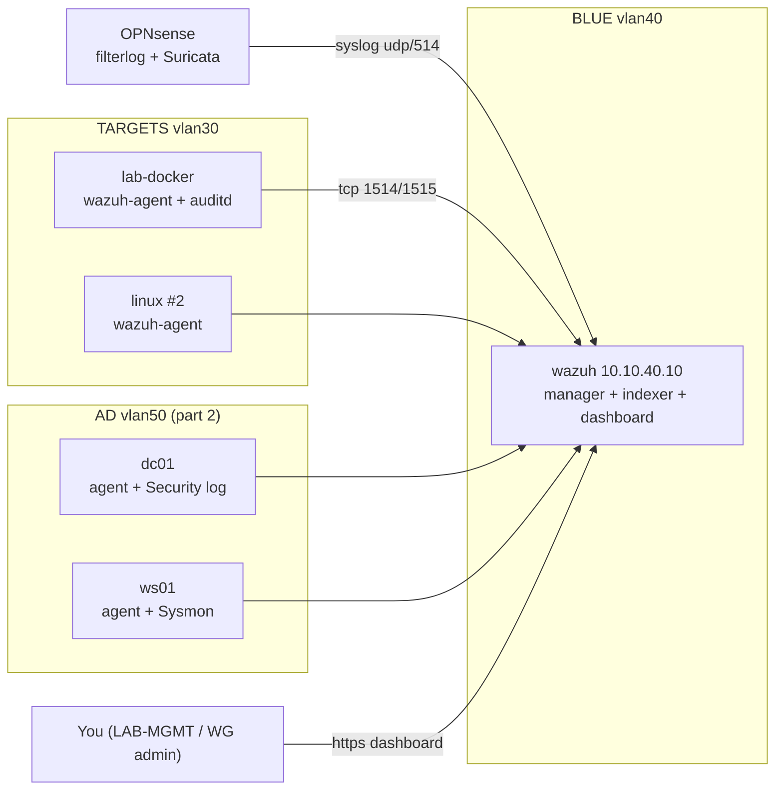

# Project 08: SOC & Detection Engineering (Wazuh)

> Build a working mini-SOC: a Wazuh SIEM collecting logs from Linux and Windows endpoints and
> your firewall, custom detection rules mapped to MITRE ATT&CK, triage tickets for real alerts,
> and finally a **purple-team** exercise where you catch your own Project 07 AD attacks.

## 1. Goal & career relevance

"A running homelab SIEM with endpoints reporting, tuned rules, and a documented history of
investigations" is the single most-cited differentiator in entry-level hiring guides (see
[what-employers-want](../../docs/what-employers-want.md)). SOC analyst is also the most common
first cyber job. This project gives you the artifacts *and* the vocabulary.

**Hiring skills proved:** SIEM deployment and administration, log sources (Windows Security,
Sysmon, auditd, syslog), alert triage, detection engineering, MITRE ATT&CK mapping, purple
teaming, Python data analysis, documentation (tickets, rule docs, playbooks).

## 2. Concepts covered

- SIEM architecture: agents, manager, indexer, dashboard; decoders → rules → alerts
- Log sources and what each sees: auth logs, auditd, Windows Security events, **Sysmon**,
  firewall/IDS syslog
- File integrity monitoring (FIM), vulnerability detection, SCA (configuration assessment)
- Detection engineering: hypothesis → data source → logic → test → tune → document
- Alert severity, false positives vs. false negatives, alert fatigue
- MITRE ATT&CK tactics and techniques; Sigma as a vendor-neutral rule format
- Triage workflow: validate → scope → contain/escalate → document

### Learn alongside (read / watch)

| Resource | Why | Time |
|---|---|---|
| [TryHackMe SOC Level 1 path](https://tryhackme.com/path/outline/soclevel1) (free rooms) | Guided SOC fundamentals: triage, SIEM, phishing, Wireshark, Windows logs | 10 h+ |
| [MITRE ATT&CK: Getting Started](https://attack.mitre.org/resources/) + browse the Windows matrix | The shared language of detections | 2 h |
| Black Hills InfoSec / Antisyphon (YouTube): "SOC Core Skills" (John Strand) | Practical SOC mindset | 4 h |
| [Wazuh documentation: Getting started](https://documentation.wazuh.com/current/getting-started/index.html) + "Proof of concept guide" | Every Wazuh feature you'll use, with worked examples | 3 h |
| [SANS Windows Event Log cheat sheet](https://www.sans.org/posters/) and [Ultimate Windows Security event encyclopedia](https://www.ultimatewindowssecurity.com/securitylog/encyclopedia/) | Look up any event ID | reference |
| [Sigma rules project](https://github.com/SigmaHQ/sigma) README + a few Windows rules | How the industry shares detections | 1 h |
| [Red Canary Threat Detection Report](https://redcanary.com/threat-detection-report/) | Which techniques attackers actually use most | 1 h |
| [MIT 6.858](https://ocw.mit.edu/courses/6-858-computer-systems-security-fall-2014/) lecture on intrusion detection / auditing (optional) | Theory behind detection | optional |

## 3. Estimated time

**20 hours total.** Part 1 (Linux, Phase 1): 12 h. Part 2 (Windows, Sysmon, purple team, Phase 2): 8 h.

## 4. Resources & profile

**Profile C** (part 1) and **Profile C+B** (part 2, purple team). **Stop prod-ubuntu.**

| VM | Segment | RAM | Disk | Notes |
|---|---|---|---|---|
| wazuh (401) | BLUE `10.10.40.10` | **5 GB**, 4 vCPU | 50 GB thin | All-in-one. Wazuh's quickstart recommends 8 GB; 5 GB works for a handful of agents **with the indexer heap capped** (step 2) |
| lab-docker (301) | TARGETS | 3 GB | — | Linux endpoint #1 |
| cp-linux clone or P04 template clone | TARGETS | 1–2 GB | — | Linux endpoint #2 (optional) |
| dc01 + ws01 (part 2) | AD | 2 + 4 GB | — | Windows endpoints |

Part 2 totals about 11 GB on one node. That's tight: use Server Core for dc01 (2 GB), close
everything else, and watch `free -h`. *Two nodes?* This is where node 2 pays off.

## 5. Prerequisites

- [ ] Projects 01–02 (BLUE VLAN exists, the TARGETS/AD → Wazuh 1514–1515 rules exist)
- [ ] For part 2: Project 07 snapshots `ad-vulnerable` / `ad-hardened`
- [ ] BLUE has internet (for packages and rule/vuln feeds)

## 6. Architecture



## 7. Build steps

### Part 1: SIEM + Linux endpoints (12 h)

**Step 1: Create the Wazuh VM (30 min).**
```bash
qm clone 9000 401 --name wazuh
qm set 401 --net0 virtio,bridge=vmbr1,tag=40 --ipconfig0 ip=10.10.40.10/24,gw=10.10.40.1 \
  --nameserver 10.10.40.1 --memory 5120 --balloon 0 --cores 4
qm disk resize 401 scsi0 50G && qm start 401
```
Ballooning is off for the SIEM: OpenSearch (the indexer) hates having memory pulled out from under it.

**Step 2: Install all-in-one + cap the heap (1 h).** Follow the
[Wazuh quickstart](https://documentation.wazuh.com/current/quickstart.html): it's one script
(`wazuh-install.sh -a`). Copy the **exact current URL** from the page; the version is in the
path. Save the admin password it prints into your password manager. Then cap the indexer's Java
heap so it fits in 5 GB:

```bash
sudo sed -i 's/^-Xms.*/-Xms1536m/; s/^-Xmx.*/-Xmx1536m/' /etc/wazuh-indexer/jvm.options
sudo systemctl restart wazuh-indexer
```
Browse to `https://10.10.40.10` from LAB-MGMT or your WireGuard admin peer (accept the
self-signed cert; P12 fixes that properly).

> Allow the dashboard through the firewall: on LAB-MGMT and WG_ADMINS, traffic to BLUE is already
> allowed. Nothing else should reach 443 on the Wazuh box.

**Step 3: Enroll Linux agents (1 h).** On each Linux endpoint, enable TARGETS TEMP egress,
add the Wazuh apt repo and install the agent pointed at the manager (exact commands in
`automation/agent-linux.sh` and the Wazuh docs), then disable TEMP egress. Also install
`auditd`. In the dashboard, confirm each agent shows **Active**.

> Agent version must be **≤ manager version**. Install the manager first with the newest
> release, then agents from the same release line.

**Step 4: Turn on the useful modules (1 h).** In the agent group config (*Server management →
Groups → default → files → agent.conf*) or each agent's `ossec.conf`:
- **FIM** on `/etc`, `/usr/bin`, `/usr/sbin`, `/root/.ssh`, `/home/*/.ssh` (realtime for `/etc/sudoers.d`, `/etc/cron.d`)
- **auditd** log collection (`/var/log/audit/audit.log`) with a few audit rules for `execve` by root and changes to `/etc/passwd`
- **SCA** (security configuration assessment, built in): run it and look at your CIS score.
  Compare it with your P04 hardening baseline!
- **Vulnerability detection** (enabled on the manager by default in recent versions)

**Step 5: Firewall and IDS logs (1 h).** OPNsense → *System → Settings → Logging → Remote*:
send **Firewall** and **Suricata/IDS** to `10.10.40.10` UDP 514. On the Wazuh manager, add a
`<remote>` syslog listener allowing only `10.10.40.1` (see `automation/ossec-remote-syslog.xml`).
Re-run a P02 nmap scan and find the firewall/Suricata events in Wazuh.

**Step 6: Generate attacks and triage them (3 h).** From Kali/RED, against your Linux endpoints:
SSH brute force (a few failed logins with `hydra` against a test account, or just failed `ssh`
attempts in a loop), add a user, add a cron job, edit `/etc/sudoers.d`, run a scan. Or use
[Atomic Red Team](https://github.com/redcanaryco/atomic-red-team) Linux tests (T1053.003 cron,
T1136.001 create account, T1548.003 sudo). For each alert that fires, write a **SOC ticket**:
what happened, true/false positive, evidence, recommended action.

**Step 7: Write custom detections (3 h).** Built-in rules miss lab-specific behavior. Write at
least **5 custom rules** in `/var/ossec/etc/rules/local_rules.xml` (IDs 100000+), each with a
MITRE ID. Ideas: sudoers or cron.d change (FIM) at high severity; a new UID-0 account; a
listener on an unusual port; a login from the RED subnet to a TARGETS host outside game night.
**Test every rule** with `sudo /var/ossec/bin/wazuh-logtest` (paste a log line, see which rule
matches), then trigger it for real. Document each with the `detection-rule` template.

**Step 8: Dashboard + tuning (1.5 h).** Build a dashboard: alerts over time, top rules, top
agents, MITRE techniques. Find your noisiest rule and tune it (raise/lower level, add an
exception for a known-benign source), and record why in the rule doc. Tuning is half the job.

### Part 2: Windows, Sysmon & purple team (8 h)

**Step 9: Windows agents + Sysmon (2 h).** On dc01 and ws01 (AD TEMP egress on): install the
Wazuh agent MSI pointed at `10.10.40.10`, then install **Sysmon** with a community config
([SwiftOnSecurity](https://github.com/SwiftOnSecurity/sysmon-config) or
[olafhartong/sysmon-modular](https://github.com/olafhartong/sysmon-modular)). Add the Sysmon
channel to the agent's `ossec.conf` (`automation/agent-windows.ps1` does both). Enable the audit
subcategories P07 needs on the DC: Kerberos Service Ticket Operations, Kerberos Authentication
Service, Logon, Security Group Management.

**Step 10: Purple team (4 h).** Roll the domain back to `ad-vulnerable`. For each P07 attack:
1. **Hypothesis:** "Kerberoasting will generate 4769 events with RC4 encryption for `svc_sql`."
2. **Attack** from Kali (exactly as in P07).
3. **Look:** did a built-in rule fire? If not, find the raw event in *Threat Hunting* / Discover.
4. **Detect:** write or tune a rule (e.g. RC4 4769 for a user SPN; a burst of 4769s from one
   user; 4625 spray across many accounts; Sysmon EID 1 with suspicious command lines; 4732
   member added to Administrators; 4698 scheduled task created).
5. **Re-run** the attack and confirm the alert. Record time-to-detect.
6. Apply the P07 fix, re-run, and document what the alert looks like now (or why it no longer fires).

Build an **ATT&CK coverage table**: technique → attack → data source → rule ID → detected? ✅/❌.
That table is the best single artifact of this whole repo.

**Step 11: Playbook (1 h).** Write an alert-handling playbook (runbook template) for your two
highest-severity rules: triage steps, what to check, when to escalate, containment.

## 8. Checkpoints

- [ ] Wazuh dashboard reachable; ≥ 2 Linux agents active; indexer heap capped and stable for a week
- [ ] FIM, auditd, SCA and vulnerability detection producing data; OPNsense syslog arriving
- [ ] ≥ 5 custom rules, each tested with `wazuh-logtest` **and** a live trigger
- [ ] ≥ 3 SOC tickets for real alerts
- [ ] Part 2: Windows agents + Sysmon; every P07 attack mapped in the ATT&CK coverage table

## 9. Exercises

1. Explain decoder vs. rule vs. alert in Wazuh, using one of your own rules.
2. A rule fires 400 times a day, and every one is benign. List 3 ways to fix it without
   losing real detections.
3. Which P07 attack was hardest to detect, and why? What data source would make it easier?
4. Write one of your Wazuh rules as a **Sigma** rule (see `automation/sigma/`). What's
   gained by a vendor-neutral format?

## 10. Coding exercises

**Before you start:** [Python primer](../../docs/python-primer.md) sections 3, 4, 5, 8 and 9.

**Python: alert analytics.** Wazuh writes every alert as one JSON object per line to
`/var/ossec/logs/alerts/alerts.json`. Write `enrich_alerts.py` that reads it (or a copy) and
prints: alerts per level, top 10 rules, top agents, alerts per **MITRE technique**, and every
alert of level ≥ 10 in a time window, with an optional CSV export for your tickets. Solution:
`automation/python/enrich_alerts.py`.

**Detection languages: XML and YAML.** Wazuh rules are XML; Sigma rules are YAML. Write
each of your 5 custom detections in both. Learning to read rule syntax quickly is a real SOC
skill. Solutions: `automation/rules/local_rules.xml` and `automation/sigma/`.

**Stretch: the Wazuh REST API.** Use `requests` to authenticate to the manager API
(`https://10.10.40.10:55000`, user `wazuh` from the install passwords file) and list agents and
their status. See [Python primer §9](../../docs/python-primer.md#9-talking-to-web-apis-requests).

## 11. Snapshot / teardown

- `qm snapshot 401 p08-tuned`. Shut Wazuh down between sessions if you need the RAM; it
  starts cleanly, though the indexer takes a few minutes.
- Roll the domain back to `ad-hardened` after the purple-team exercise.

## 12. Stretch goals

- **Active response:** auto-block an IP on the Linux agent after an SSH brute force (Wazuh
  `firewall-drop`), and discuss the risk of automated blocking.
- Integrate **Suricata EVE JSON** from lab-docker (run Suricata there) for richer network alerts.
- Send Wazuh alerts to a Discord channel with a webhook integration (game nights!).
- Try **Security Onion** or **Elastic** later on a 32 GB node and compare.

## 13. Documentation deliverables

| Deliverable | Template |
|---|---|
| ≥ 5 detection-rule docs (logic, ATT&CK, test, false positives) | `detection-rule` (suffix per rule) |
| ≥ 3 SOC tickets for real alerts | `soc-ticket` (suffix per ticket) |
| Alert-handling playbook (2 high-severity rules) | `runbook-sop` (suffix `alert-playbook`) |
| Purple-team summary with ATT&CK coverage table (part 2) | `after-action-report` (suffix `purple-team`) |
| SIEM architecture section in your P01 network design doc | update P01 doc |

## 14. Definition of done

- [ ] Checkpoints ticked; dashboards screenshotted for the portfolio
- [ ] Rule docs, tickets, playbook and purple-team summary written
- [ ] `enrich_alerts.py` working on your real alerts
- [ ] Resume bullet + path-finder rating

## 15. Resume bullets

- *Deployed a Wazuh SIEM (manager, indexer, dashboard) on constrained hardware, onboarding
  Linux and Windows endpoints with Sysmon, auditd, FIM, and OPNsense firewall/IDS syslog.*
- *Authored 7 custom detection rules mapped to MITRE ATT&CK and validated them with Atomic Red
  Team and live attacks; built an ATT&CK coverage matrix from a purple-team exercise that
  detected Kerberoasting, AS-REP roasting and password spraying.*
- *Triaged and documented real alerts as SOC tickets; tuned noisy rules to reduce false positives.*

## 16. References

- [Wazuh docs](https://documentation.wazuh.com/current/) · [Ruleset XML syntax](https://documentation.wazuh.com/current/user-manual/ruleset/ruleset-xml-syntax/rules.html) · [wazuh-logtest](https://documentation.wazuh.com/current/user-manual/reference/tools/wazuh-logtest.html)
- [Sysmon (Microsoft Sysinternals)](https://learn.microsoft.com/en-us/sysinternals/downloads/sysmon) · [SwiftOnSecurity config](https://github.com/SwiftOnSecurity/sysmon-config)
- [Atomic Red Team](https://github.com/redcanaryco/atomic-red-team) · [Sigma](https://github.com/SigmaHQ/sigma)
- [MITRE ATT&CK](https://attack.mitre.org) · [ATT&CK Navigator](https://mitre-attack.github.io/attack-navigator/)
- [Ultimate Windows Security event encyclopedia](https://www.ultimatewindowssecurity.com/securitylog/encyclopedia/)
