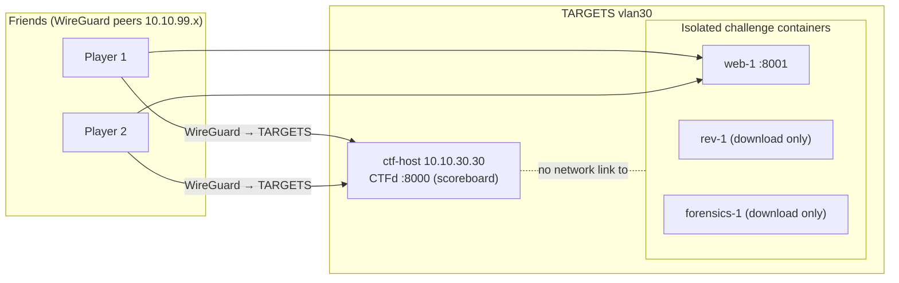

# Project 09: Host Your Own CTF

> Stand up a CTFd scoreboard and build a handful of your own challenges (web, crypto, forensics,
> OSINT, reversing), each isolated in Docker, then run a capture-the-flag night for your
> friends over WireGuard. Designing challenges teaches you more than solving them.

## 1. Goal & career relevance

Building challenges forces you to understand a vulnerability class well enough to create,
isolate and score it. Running an event is project management, documentation and ops. Both read
well on a resume and both are genuinely fun, which keeps you in the lab.

**Hiring skills proved:** Docker and service isolation, challenge/vulnerability design across
domains, platform administration, writing clear instructions, event operations, Python.

## 2. Concepts covered

- CTF formats (jeopardy vs. attack/defense) and categories
- CTFd administration: challenges, flags, hints, dynamic scoring, teams
- Containerizing challenges safely; one network per challenge; resource limits
- Flag design (`flag{...}`), preventing flag sharing, difficulty curves
- Hosting for friends over WireGuard without exposing anything to the internet

### Learn alongside (read / watch)

| Resource | Why | Time |
|---|---|---|
| [picoCTF](https://picoctf.org/) + [picoGym](https://play.picoctf.org/practice) | Play beginner challenges to learn what good ones feel like | 4 h |
| [OverTheWire Bandit/Natas](https://overthewire.org/wargames/) | Classic Linux and web wargames to borrow ideas from | 3 h |
| [CTFd docs](https://docs.ctfd.io/) | Running the platform | 1 h |
| [CTF Field Guide (Trail of Bits)](https://trailofbits.github.io/ctf/) | How challenges in each category work | 2 h |
| John Hammond (YouTube): "how to make a CTF challenge" videos | Practical challenge design | 1 h |
| [MIT 6.100L](https://ocw.mit.edu/courses/6-100l-introduction-to-cs-and-programming-using-python-fall-2022/) if you want more Python first | For the generator exercise | optional |

## 3. Estimated time

**10 hours.** 2 h CTFd, 5 h building 5 challenges, 1 h testing, 2 h running the event + retro.

## 4. Resources & profile

**Profile E.** ctf-host (VMID 303) on TARGETS `10.10.30.30`, 2 GB, 20 GB disk, Docker.
Friends connect over WireGuard (P03) to the TARGETS VLAN. lab-docker can host extra challenge
containers if needed.

## 5. Prerequisites

- [ ] Projects 01–03 (TARGETS VLAN, Docker skills, WireGuard for friends)
- [ ] Friends onboarded as WireGuard peers with the game-night rules
- [ ] Rules of engagement / event plan drafted

## 6. Architecture



## 7. Build steps

### Step 1: Deploy CTFd (1.5 h)

On ctf-host (TEMP egress on to pull images):
```bash
git clone https://github.com/CTFd/CTFd.git ~/CTFd && cd ~/CTFd
docker compose up -d
```
Browse `http://10.10.30.30:8000` from a WireGuard peer or LAB-MGMT, run the setup wizard
(admin account, event name, visibility). Disable TEMP egress afterwards. CTFd uses about 1 GB.

> Keep CTFd on a separate Docker network from the challenge containers so a player who pops a
> challenge can't reach the scoreboard database. `automation/compose/` keeps them apart.

### Step 2: Design the challenge set (30 min)

Plan 5 challenges with a difficulty curve. One per category is a good spread:

| # | Category | Idea | Difficulty |
|---|---|---|---|
| 1 | OSINT / misc | A flag hidden in EXIF metadata of an image | easy |
| 2 | Crypto | Base64 → ROT13 → hex chain; or a reused XOR key | easy/med |
| 3 | Web | A cookie/JWT you can tamper with, or basic SQLi on a toy app you write | medium |
| 4 | Forensics | A pcap (from P02) with a flag in an HTTP object, or a file with hidden data | medium |
| 5 | Reversing | A small C binary that checks a password (from your P06 C work) | medium/hard |

Document each in a challenge design doc: category, flag, intended solution, hints, point value,
and how it's isolated.

### Step 3: Build the challenges (4 h)

- **Flags** follow one format, e.g. `homelab{...}`. Make them unique per challenge.
- **Isolation:** each networked challenge is its own container with `mem_limit`, no access to
  the host or other challenges, and only the port it needs. Use `automation/compose/challenges.yml`.
- **Static challenges** (crypto, forensics, reversing, OSINT) are just files players download
  from CTFd; no running service needed. Safer and lighter.
- The flag generator `automation/python/make_challenges.py` builds the crypto chain and the
  EXIF image and prints the flags for your answer key.
- For the reversing challenge, compile a small C "password checker" (strip symbols:
  `gcc -s`), and have players find the password with `strings`, `ltrace` or Ghidra.

### Step 4: Test everything (1 h)

Solve every challenge yourself from a clean WireGuard peer (not the host). Confirm: the flag is
accepted, hints work, and a player **cannot** reach the host, the scoreboard DB, or another
challenge's internals. Have one friend test early.

### Step 5: Run the event (2 h) and retro

- Set a start/end time, share the WireGuard configs and the scoreboard URL, open a voice chat.
- Watch the scoreboard; drop a hint if everyone's stuck on one challenge.
- Afterwards, publish solutions and write a **retro** (after-action report): what was too
  easy/hard, what broke, what you'd change.

## 8. Checkpoints

- [ ] CTFd reachable by a friend over WireGuard; isolated from challenge networks
- [ ] 5 challenges across ≥ 4 categories, each with a unique flag and tested solution
- [ ] A friend solved at least one and could not reach the host or the DB
- [ ] Event run; solutions and retro published

## 9. Exercises

1. For each challenge, write the real-world skill it teaches (EXIF → metadata in investigations;
   JWT tampering → broken auth; pcap → network forensics).
2. How would you stop flag sharing between teams? (Per-team dynamic flags; CTFd supports this.)
3. One challenge container is compromised by a player. Prove it can't reach the scoreboard or
   another challenge. What Docker settings enforce that?

## 10. Coding exercises

**Before you start:** [Python primer](../../docs/python-primer.md) sections 1 and 7.

**Python: challenge generator.** Write `make_challenges.py` that generates: (a) the multi-layer
crypto string and its flag, (b) an image with the flag written into an EXIF field, and (c) a
`challenges.csv` for CTFd bulk import. Keeping generation in code means you can re-roll flags
for each event. Solution: `automation/python/make_challenges.py`.

**C: a password-check reversing challenge.** Write a short C program that reads a password and
prints the flag only if it matches, then compile it stripped (`gcc -s -O2`). Players reverse it.
Writing it teaches you what reversers look for (string comparisons, `strcmp`, constants).
Solution: `automation/c/checker.c` + `Makefile`.

## 11. Snapshot / teardown

- `docker compose down` on challenge containers after the event.
- Snapshot ctf-host with CTFd configured so you can reuse it.
- Keep flags/answers out of the public repo if you'll reuse challenges.

## 12. Stretch goals

- Try the **attack/defense** format using your P04/P05 images (bridges to P10).
- Add a dynamic-scoring, first-blood-bonus event.
- Build a challenge from a real CVE using a Vulhub environment.
- Export your challenges as a reusable pack for the next event.

## 13. Documentation deliverables

| Deliverable | Template |
|---|---|
| Event plan (schedule, access, rules, scoring) | `runbook-sop` (suffix `ctf-event`) |
| Challenge design docs (one table or file) | `runbook-sop` (suffix `challenge-design`) |
| Post-event retro | `after-action-report` (suffix `ctf-retro`) |

## 14. Definition of done

- [ ] Checkpoints ticked
- [ ] Event plan, challenge design doc and retro written
- [ ] Python generator and C reversing challenge built
- [ ] Resume bullet + path-finder rating

## 15. Resume bullets

- *Designed and hosted a jeopardy-style capture-the-flag event on CTFd with challenges across
  web, crypto, forensics, OSINT and reversing, each isolated in resource-limited Docker
  containers; delivered access securely to remote players over WireGuard.*
- *Automated challenge and flag generation in Python for repeatable events.*

## 16. References

- [CTFd](https://github.com/CTFd/CTFd) · [docs](https://docs.ctfd.io/)
- [CTF Field Guide](https://trailofbits.github.io/ctf/) · [picoCTF](https://picoctf.org/)
- [Awesome CTF](https://github.com/apsdehal/awesome-ctf) (tools and challenge ideas)
