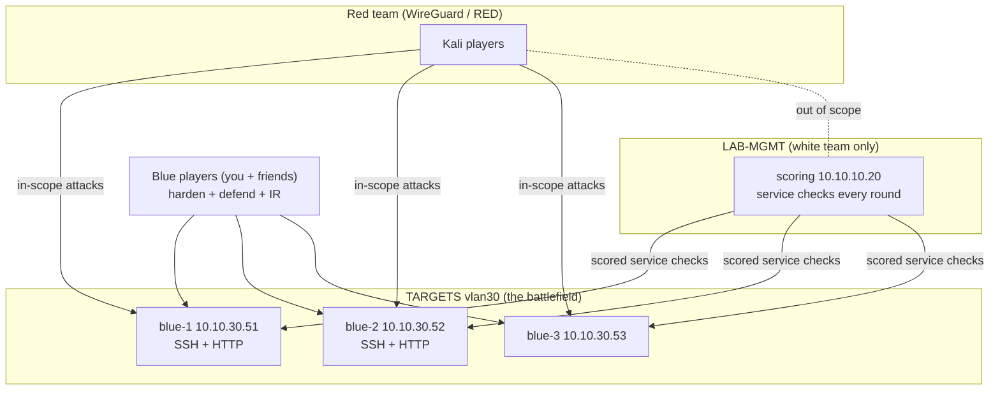

# Project 10: Red vs Blue Game Night

> Run a CCDC-style defense exercise with friends: blue teams keep services online and hardened
> while a red team tries to disrupt them, with an automatic scoring engine tracking uptime.
> This pulls together everything from Projects 01–08.

## 1. Goal & career relevance

This is the closest you'll get to real incident response without a real incident: defending
live services under pressure, triaging what's happening, and communicating as a team. It shows
employers you can operate, not just configure. It's also how CCDC (Collegiate Cyber Defense
Competition) works, which is worth looking into with your school.

**Hiring skills proved:** defensive operations under pressure, incident response, hardening,
teamwork and communication, rules-of-engagement discipline, running scored infrastructure.

## 2. Concepts covered

- Attack/defense exercise format; service availability scoring (the "scoring engine")
- Rules of engagement, scope, and a white team (referee)
- Blue team: harden fast, keep required services up, detect and evict the red team, write
  incident reports
- Red team: disrupt in-scope services within the rules
- The tension between hardening and availability (over-harden and you fail the service check)

### Learn alongside (read / watch)

| Resource | Why | Time |
|---|---|---|
| [National CCDC](https://www.nationalccdc.org/) rules and about pages | The format you're emulating, and a real competition to join | 1 h |
| [scoringengine docs](https://scoringengine.readthedocs.io/) | The uptime scorer you'll run | 1 h |
| Black Hills InfoSec (YouTube): "Cyber Defense" / blue-team talks | Defender mindset under pressure | 2 h |
| Your own Projects 04/05 (hardening) and 08 (detection) | You'll reuse those skills live | review |
| [MITRE ATT&CK](https://attack.mitre.org) | Name what the red team does in your incident reports | reference |

## 3. Estimated time

**12 hours.** 4 h build the game environment + scoring, 1 h dry run, 4 h event, 3 h reports/AAR.

## 4. Resources & profile

**Profile D. Stop prod-ubuntu** if you add Windows boxes.

| VM | Segment | RAM | Notes |
|---|---|---|---|
| scoring (110) | LAB-MGMT `10.10.10.20` | 2 GB | scoringengine (Docker); white-team only |
| rvb-blue-1..3 (321–323) | TARGETS `10.10.30.51–.53` | 1.5 GB each | the defended boxes (clone your P04 Linux image; add a Windows one if RAM allows) |
| Red team | WireGuard peers / RED | — | friends bring their own Kali |

Scoring box lives on LAB-MGMT so red can't take the scoreboard down (it's out of scope).
Friends reach TARGETS over WireGuard; the reverse-shell rule (P06) is enabled for the game.

## 5. Prerequisites

- [ ] Projects 01–06 done; P04 Linux image template to clone as blue boxes
- [ ] Friends onboarded over WireGuard; everyone has read the RoE
- [ ] A voice channel (Discord) and a shared incident-report location

## 6. Architecture



## 7. Build steps

### Step 1: Deploy the scoring engine (1.5 h)

On the scoring VM (TEMP egress on to build):
```bash
git clone https://github.com/scoringengine/scoringengine.git ~/se && cd ~/se
# edit bin/competition.yaml to describe your teams and services (see automation/competition.yaml)
docker compose build
SCORINGENGINE_OVERWRITE_DB=true docker compose up -d
```
Browse `http://10.10.10.20` from LAB-MGMT. The engine checks each team's services every round
and shows a live scoreboard. Disable TEMP egress after the build.

### Step 2: Build the blue boxes (1.5 h)

Clone your P04 Linux image (or a fresh Ubuntu) three times as blue-1..3 on TARGETS. Each runs
the **scored services** (start simple: SSH and a web page). Give each blue team identical boxes
so it's fair. Create the scored service accounts the engine will log in with (defined in
`competition.yaml`). Snapshot each as `game-start`.

### Step 3: Write the rules (1 h)

Use the `rules-of-engagement` template. Decide and write down:
- **Scope:** blue boxes 10.10.30.51–.53 only. Out of scope: scoring box, OPNsense, Proxmox,
  anyone's home network, the WireGuard config.
- **Scored services** that must stay up (uptime = points).
- **Allowed red actions** and **forbidden** ones (no DoS/resource exhaustion on a shared 16 GB
  host; no attacking the scoring engine; no wiping the whole box unless agreed).
- **Blue rules:** may harden and patch, but may **not** block the scoring engine (10.10.10.20)
  or take a scored service offline to "protect" it.
- An **emergency stop word** anyone can call.
- Scoring: service uptime + red flag captures − penalties (e.g. blocking the scorer).

### Step 4: Dry run (30 min)

Run the engine against the untouched boxes and confirm green checks. Have one person attack one
box and confirm the score drops when a service goes down. Fix any check that's flaky before the
real game.

### Step 5: Play (4 h)

- **First 30 min: hardening window**, no attacks (change passwords, patch, review P04 checklist).
- Then open attacks. Blue teams defend, triage, and **write an incident report per intrusion**
  (template). Red team keeps notes for their report.
- White team (you, if solo-hosting) watches the scoreboard, enforces the RoE, and injects a
  twist if things stall ("a 'CEO' emails asking you to open port X").

### Step 6: Debrief

Everyone shares reports. Write the **after-action report**: timeline, what red got in through,
what blue caught, final scores, lessons. Map red's actions to ATT&CK.

## 8. Checkpoints

- [ ] Scoring engine live on LAB-MGMT; scoreboard reachable; checks green at start
- [ ] 3 identical blue boxes with scored services; snapshotted `game-start`
- [ ] Signed RoE; emergency stop word agreed
- [ ] Dry run proved the score drops when a service goes down
- [ ] Event run; incident reports + AAR written

## 9. Exercises

1. Explain the hardening-vs-availability tension with a concrete example from the game (a change
   that improved security but broke a scored service).
2. Pick one intrusion and write the full detection story: what log/alert would have caught it
   sooner? (Wire your P08 Wazuh into the blue boxes for a bonus round.)
3. Design a fair scoring formula. How do you weight uptime vs. red captures vs. incident-report
   quality?

## 10. Coding exercises

**Before you start:** [Python primer](../../docs/python-primer.md) sections 10 and 12.

**Python: your own service-uptime checker.** Before relying on scoringengine, write
`service_check.py` that checks a list of host:service targets (TCP connect, HTTP 200, SSH banner)
concurrently with `ThreadPoolExecutor`, prints a scoreboard, and appends a timestamped row to a
CSV each run. Run it on a cron every minute during a mini-game. This is literally what a scoring
engine does. Solution: `automation/python/service_check.py`.

**Bash/ops:** write a `reset-game.sh` for the Proxmox host that rolls all blue boxes back to
`game-start` between rounds. Solution: `automation/reset-game.sh`.

## 11. Snapshot / teardown

- Roll blue boxes back to `game-start` between rounds with `reset-game.sh`.
- `docker compose down` the scoring engine after the event.
- Disable the TARGETS → WG reverse-shell rule when done.

## 12. Stretch goals

- Wire **Wazuh (P08)** into the blue boxes so blue teams triage real alerts during the game
  (full purple-team night).
- Add Windows blue boxes (from P05) if you have the RAM or a second node.
- Add **inject** scenarios (business tasks the white team assigns) like real CCDC.
- Rotate red/blue roles and replay.

## 13. Documentation deliverables

| Deliverable | Template |
|---|---|
| Rules of engagement | `rules-of-engagement` (suffix `game-night`) |
| Red team report (if you played red) | `pentest-report` (suffix `red-team`) |
| Blue incident reports (one per intrusion) | `incident-report` (suffix per incident) |
| After-action report with scores and ATT&CK mapping | `after-action-report` (suffix `game-night`) |

## 14. Definition of done

- [ ] Checkpoints ticked
- [ ] RoE, incident reports and AAR written; scoreboard screenshotted
- [ ] `service_check.py` and `reset-game.sh` working
- [ ] Resume bullet + path-finder rating (did you prefer red or blue?)

## 15. Resume bullets

- *Organized and ran a CCDC-style red-versus-blue defense exercise for N participants with an
  automated service-uptime scoring engine, written rules of engagement, and a white-team
  referee role.*
- *Defended live services under active attack, producing incident reports mapped to MITRE
  ATT&CK and an after-action review.*
- *Built a concurrent Python service-availability checker used to validate the scoring setup.*

## 16. References

- [scoringengine](https://github.com/scoringengine/scoringengine) · [docs](https://scoringengine.readthedocs.io/)
- [National CCDC](https://www.nationalccdc.org/) · [regional CCDC info](https://www.nationalccdc.org/index.php/competition/competitors/regionals)
- [MITRE ATT&CK](https://attack.mitre.org)
