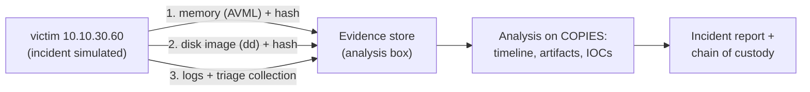

# Project 11: DFIR & Incident Response

> Investigate a simulated compromise end to end: preserve evidence with a chain of custody,
> collect disk, memory and log artifacts, build a timeline, find the intruder's persistence, and
> write a professional incident report. Then practice memory forensics on public challenge images.

## 1. Goal & career relevance

DFIR (digital forensics and incident response) is where security gets investigative. Even SOC
analysts and sysadmins are expected to handle evidence properly and reconstruct "what happened".
A clean incident report with a defensible timeline is one of the strongest writing samples you
can show.

**Hiring skills proved:** incident response lifecycle (NIST SP 800-61), evidence handling and
chain of custody, Linux log and filesystem forensics, memory forensics (Volatility 3), timeline
analysis, IOC extraction, report writing, Python and C++ tooling.

## 2. Concepts covered

- NIST SP 800-61 IR lifecycle: preparation, detection & analysis, containment, eradication,
  recovery, post-incident activity
- Order of volatility: memory → network state → processes → disk → logs → backups
- Evidence integrity: hashing (SHA-256), write-blocking, working on copies, chain of custody
- Linux artifacts: `auth.log`/journal, `bash_history`, cron, systemd units, `/tmp`, new users,
  SUID files, file timestamps (mtime/atime/ctime/birth)
- Memory forensics: process lists, network connections, command lines, injected code
- Timelines, IOCs, and attribution limits (facts vs. inferences)

### Learn alongside (read / watch)

| Resource | Why | Time |
|---|---|---|
| [NIST SP 800-61r3](https://csrc.nist.gov/pubs/sp/800/61/r3/final) (incident response recommendations) | The framework your report follows | 2 h |
| 13Cubed (YouTube): "Introduction to Memory Forensics", Linux forensics episodes | The best free DFIR video channel | 3 h |
| [Volatility 3 docs](https://volatility3.readthedocs.io/) | Memory analysis tool you'll use | 1 h |
| [The DFIR Report](https://thedfirreport.com/) (pick 2 reports) | How real intrusions unfold and get written up | 2 h |
| [CyberDefenders](https://cyberdefenders.org/) and [Blue Team Labs Online](https://blueteamlabs.online/) free DFIR labs | Practice images with answers | 4 h+ |
| [SANS DFIR posters/cheat sheets](https://www.sans.org/posters/) | Artifact references to keep open | reference |
| [MIT 6.1810 / 6.S081](https://pdos.csail.mit.edu/6.S081/) file systems lectures (optional) | What timestamps and inodes really are | optional |

## 3. Estimated time

**12 hours.** 1 h setup + simulation, 2 h acquisition, 4 h analysis + timeline, 2 h memory lab,
3 h report and chain-of-custody docs.

## 4. Resources & profile

**Profile A (light).**

| VM | Segment | RAM | Notes |
|---|---|---|---|
| victim (clone of template 9000, VMID 330) | TARGETS `10.10.30.60` | 1.5 GB | the "compromised" host |
| analysis box (lab-docker or your laptop) | — | — | runs the analysis; evidence stored here, never on the victim |

Memory images for Volatility come from public challenge sites (or your own capture). Keep
them inside the lab (see [safety](../../docs/safety-and-legal.md)).

## 5. Prerequisites

- [ ] Projects 01, 02, 04 (Linux artifacts), 08 (log thinking)
- [ ] Python 3 with `volatility3` installed on the analysis box (`pip install volatility3`)
- [ ] An evidence folder **outside git** (`evidence/` is in `.gitignore`)

## 6. Architecture

## 7. Build steps

### Step 1: Create the incident (30 min)

Clone a victim VM and have a **friend** run `automation/incident-sim.sh` on it without telling
you what it does (or run it yourself and try to forget, but a friend is better). It simulates an
intrusion with **inert** artifacts: a backdoor user, a persistence mechanism, a staged file in a
hidden directory, shell history, and log noise. Snapshot `post-incident`. You don't touch the
victim's disk again except to collect evidence.

### Step 2: Acquire evidence in order of volatility (2 h)

Start a **chain-of-custody** form now and update it every time evidence moves.

1. **Memory first.** [AVML](https://github.com/microsoft/avml) is a single static binary
   (download on the analysis box, copy over). `sudo ./avml /tmp/mem.lime`, then copy it off and
   hash it: `sha256sum mem.lime`.
2. **Volatile state:** `ss -tulpn`, `ps auxf`, `who`, `last`, `ip a`, `crontab -l` for each
   user, saved with timestamps (`automation/triage-collect.sh` does this).
3. **Disk:** from the Proxmox host, image the VM disk while it's stopped (`qm stop`, then `dd`
   the LV or `qemu-img convert` to raw). Hash source and copy; they must match.
4. Record every hash in the chain-of-custody form. **Analyze only copies.**

### Step 3: Analyze (4 h)

Mount the disk image read-only (`mount -o ro,loop,noexec`) on the analysis box and work through:
- Accounts: diff `/etc/passwd` / `/etc/group` against the template; new sudoers entries
- Persistence: `/etc/cron*`, `/var/spool/cron/crontabs/`, systemd units in `/etc/systemd/system`,
  `~/.bashrc`, `/etc/profile.d`, `authorized_keys`
- Execution evidence: `.bash_history` per user, `/var/log/auth.log`, `journalctl --file`
- Staging: hidden directories under `/tmp`, `/var/tmp`, `/dev/shm`; recently modified files
  (`find / -newermt '<incident date>'`)
- Build a **timeline** of everything (the Python exercise automates this)

Write every finding as *observed fact* (with source path and hash) vs. *inference*.

### Step 4: Memory forensics lab (2 h)

Linux memory analysis with Volatility needs a symbol table matching the exact kernel, which is
fiddly. Learn the workflow on a **public Windows or Linux challenge image** first (CyberDefenders
and 13Cubed publish them, with answers). Practice: `windows.pslist`, `windows.pstree`,
`windows.netscan`, `windows.cmdline`, `windows.malfind` (or the `linux.*` equivalents). Then, as a
stretch, build a symbol table for your victim's kernel and analyze your own `mem.lime`.

### Step 5: Report (3 h)

Write the incident report (template): executive summary, timeline, scope, technical analysis
mapped to ATT&CK, IOCs, root cause, containment/eradication/recovery actions, lessons learned.
Then check your answers against `automation/answer-key.md`.

## 8. Checkpoints

- [ ] Evidence acquired in order of volatility; every item hashed and logged in the chain of custody
- [ ] All simulated artifacts found (check the answer key only afterwards)
- [ ] A complete timeline from first to last malicious action
- [ ] One public memory image analyzed with Volatility 3
- [ ] Incident report written

## 9. Exercises

1. Why memory before disk? Give two artifacts that exist only in memory.
2. Your copy's hash doesn't match the original. What do you do, and what does it mean for the case?
3. Explain mtime vs. ctime vs. atime, and how an attacker might tamper with them (`touch -d`).
   Which one is hardest to fake from user space?
4. Map each finding to a MITRE ATT&CK technique.

## 10. Coding exercises

**Before you start:** [Python primer](../../docs/python-primer.md) sections 4, 5, 7 and 8.

**Python: mini super-timeline.** Write `build_timeline.py` that takes a mounted image root and
produces one sorted CSV timeline from: file mtimes under chosen directories, `auth.log` lines
(parsed timestamps), and timestamped `.bash_history` entries (`#<epoch>` lines). Super-timelines
are how investigators see an incident at a glance (the real tool is Plaso). Solution:
`automation/python/build_timeline.py`.

**C++: a file carver.** Deleted files often still exist as raw bytes. Write a carver that scans a
disk image for JPEG headers (`FF D8 FF`) and footers (`FF D9`) and writes each carved image to
its own file, the core idea behind PhotoRec/Foremost. You'll practice binary I/O, buffers and
searching byte patterns efficiently.
- Learn first: [learncpp.com](https://www.learncpp.com/) chapters on file I/O and `std::vector`;
  [Wikipedia: list of file signatures](https://en.wikipedia.org/wiki/List_of_file_signatures).
- Solution: `automation/cpp/carver.cpp` + `Makefile` (test image generator included).

## 11. Snapshot / teardown

- Keep evidence outside git; delete memory/disk images when the case is closed (they're large).
- Roll back or destroy the victim VM.

## 12. Stretch goals

- Run **Plaso/log2timeline** on your disk image and compare with your Python timeline.
- Write **YARA** rules for the staged file and scan the image (`yara -r`).
- Do a Windows investigation: capture memory from ws01 (P07) with a free tool and look for the
  P07 attack traces.
- Practice a full CyberDefenders "Endpoint Forensics" lab and write it up.

## 13. Documentation deliverables

| Deliverable | Template |
|---|---|
| Incident report (exec summary, timeline, ATT&CK, IOCs, root cause, lessons) | `incident-report` (suffix `sim-001`) |
| Chain of custody for every evidence item | `chain-of-custody` (suffix `sim-001`) |
| Volatility memory-lab write-up | `ctf-writeup` (suffix `memory-lab`) |

## 14. Definition of done

- [ ] Checkpoints ticked
- [ ] Incident report, chain of custody and memory write-up written
- [ ] Python timeline and C++ carver working
- [ ] Resume bullet + path-finder rating

## 15. Resume bullets

- *Investigated a simulated Linux compromise following NIST SP 800-61: acquired memory and disk
  evidence in order of volatility with SHA-256-verified chain of custody, reconstructed a full
  timeline, and identified persistence and staging artifacts mapped to MITRE ATT&CK.*
- *Analyzed memory images with Volatility 3 and wrote a professional incident report.*
- *Built a Python super-timeline generator and a C++ JPEG file carver.*

## 16. References

- [NIST SP 800-61r3](https://csrc.nist.gov/pubs/sp/800/61/r3/final) · [NIST SP 800-86 (forensics in IR)](https://csrc.nist.gov/pubs/sp/800/86/final)
- [Volatility 3](https://github.com/volatilityfoundation/volatility3) · [AVML](https://github.com/microsoft/avml)
- [Plaso](https://github.com/log2timeline/plaso) · [YARA](https://yara.readthedocs.io/)
- [The DFIR Report](https://thedfirreport.com/) · [13Cubed](https://www.13cubed.com/)
