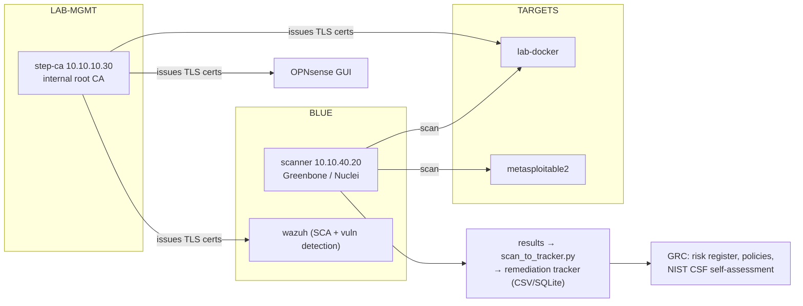

# Project 12: Vulnerability Management, Data Security & GRC

> Run a real vulnerability-management cycle on your lab (scan → prioritize → remediate →
> verify), protect data with your own certificate authority, TLS and encryption at rest, and
> write the governance documents (policies, risk register, NIST CSF self-assessment) that tie it
> together.

## 1. Goal & career relevance

The ISC2 hiring research ranked **data security** as the top early-career technical skill, and
GRC roles ask for NIST CSF / 800-53 familiarity (see
[what-employers-want](../../docs/what-employers-want.md)). Vulnerability management is also a
core day-to-day function in almost every security team. This project covers all three with
artifacts that look exactly like workplace documents.

**Hiring skills proved:** vulnerability scanning and prioritization (CVSS, EPSS, CISA KEV),
remediation tracking with SLAs, PKI and TLS, encryption at rest and in backups, secrets
handling, policy writing, risk assessment, NIST CSF 2.0, Python + SQL data handling.

## 2. Concepts covered

- Vulnerability lifecycle; authenticated vs. unauthenticated scans; false positives
- Prioritization: CVSS (severity) vs. EPSS (likelihood of exploitation) vs. CISA KEV (known
  exploited); asset criticality; SLAs
- Configuration compliance (CIS via Lynis/OpenSCAP/Wazuh SCA)
- PKI: root vs. intermediate CAs, certificate signing, trust stores, certificate lifetimes, ACME
- TLS configuration; encryption at rest (LUKS); encrypted, tested backups; secrets management
- GRC: policy hierarchy (policy → standard → procedure), risk = likelihood × impact, risk
  treatment, NIST CSF 2.0 functions (Govern, Identify, Protect, Detect, Respond, Recover)

### Learn alongside (read / watch)

| Resource | Why | Time |
|---|---|---|
| [NIST CSF 2.0](https://www.nist.gov/cyberframework) (the Framework document + quick-start guides) | The framework your self-assessment uses | 2 h |
| [NIST SP 800-53 Rev. 5](https://csrc.nist.gov/pubs/sp/800/53/r5/upd1/final) (browse AC, IA, SC, SI families) | The control catalog GRC jobs reference | 1.5 h |
| [FIRST: CVSS v3.1 user guide](https://www.first.org/cvss/v3.1/user-guide) + [EPSS](https://www.first.org/epss/) | How to score and prioritize | 1 h |
| [CISA Known Exploited Vulnerabilities](https://www.cisa.gov/known-exploited-vulnerabilities-catalog) | What attackers actually use | 30 min |
| [CS50 Cybersecurity](https://cs50.harvard.edu/cybersecurity/) "Securing Data" + "Securing Systems" lectures | Encryption, hashing and keys explained clearly | 3 h |
| [Dan Boneh: Cryptography I](https://www.coursera.org/learn/crypto) weeks 1–2 (audit free) | Symmetric crypto foundations | optional |
| [Smallstep: "Everything you should know about certificates and PKI"](https://smallstep.com/blog/everything-pki/) | The clearest PKI explainer online | 1 h |
| [Mozilla SSL Configuration Generator](https://ssl-config.mozilla.org/) | What a good TLS config looks like | 15 min |
| [CS50x](https://cs50.harvard.edu/x/) SQL week, or [SQLBolt](https://sqlbolt.com/) | For the SQL exercise | 2 h |

## 3. Estimated time

**16 hours.** Vuln mgmt 6 h, data security 5 h, GRC documents 5 h.

## 4. Resources & profile

**Profile F.**

| VM | Segment | RAM | Notes |
|---|---|---|---|
| scanner (402) | BLUE `10.10.40.20` | 4 GB | Greenbone Community Edition (Docker) **or** the lighter Nuclei (500 MB) |
| step-ca (LXC 120) | LAB-MGMT `10.10.10.30` | 256 MB | your internal certificate authority |
| lab-docker, metasploitable2 | TARGETS | 3.5 GB | scan targets |

Greenbone is the "real" network vulnerability scanner but its feed sync is slow and it wants
4 GB+. If RAM is tight, do the cycle with **Nuclei + Lynis + Wazuh SCA** instead; the process is
what matters.

## 5. Prerequisites

- [ ] Projects 01, 04, 06, 08 (targets exist, you understand the findings, Wazuh SCA is on)
- [ ] BLUE can reach TARGETS (scan rule from P01) and the internet (feeds)

## 6. Architecture

## 7. Build steps

### Part A: Vulnerability management cycle (6 h)

1. **Asset inventory first** (you can't protect what you don't know): list every lab host with
   owner, purpose, criticality (from your P01 IPAM). Vuln management starts here.
2. **Scan.** Either:
   - **Greenbone Community Edition** on the scanner VM using the
     [official Docker Compose setup](https://greenbone.github.io/docs/latest/22.4/container/)
     (wait for the feed sync; it can take an hour+), then scan TARGETS; or
   - **Nuclei** (`nuclei -u http://10.10.30.10:3000 -jsonl -o nuclei.jsonl` and a host list),
     plus `nmap -sV --script vuln` for network services.
   Add **configuration compliance**: Lynis on a Linux host, and Wazuh's SCA results from P08.
3. **Triage.** Remove false positives (verify a sample by hand; you know these targets from
   P06). Note authenticated vs. unauthenticated differences.
4. **Prioritize.** For each real finding: CVSS score, EPSS probability, KEV status, asset
   criticality. Write your prioritization rule down (e.g. "KEV or EPSS > 0.1 on an
   internet-reachable asset = Critical SLA").
5. **Track.** Load results into the remediation tracker with SLA due dates (the Python
   exercise automates this: `scan_to_tracker.py`).
6. **Remediate** a few (patch, reconfigure, or formally **accept** the risk: Metasploitable is
   a deliberately vulnerable asset, so document a risk acceptance with compensating controls:
   isolated VLAN, no egress).
7. **Verify** with a re-scan and update the tracker. Report metrics: open by severity, % within
   SLA, mean time to remediate.

### Part B: Data security (5 h)

1. **Internal CA.** Create a Debian LXC (VMID 120, LAB-MGMT `10.10.10.30`) and install
   [step-ca](https://smallstep.com/docs/step-ca/installation/) (or use the Docker alternative in
   `automation/`). Initialize a root + intermediate CA. **Keep the root key offline** (export it
   to an encrypted USB / your password manager and remove it from the LXC); that's how real CAs
   protect the root.
2. **Issue certificates** for the Wazuh dashboard, OPNsense GUI and CTFd (or one of them) with
   short lifetimes, install them, and add your root CA to your laptop's trust store. No more
   browser warnings, because the trust chain is real now. Verify with
   `openssl s_client -connect 10.10.40.10:443 -showcerts`.
3. **TLS hardening.** Compare a service's TLS config against the Mozilla "intermediate"
   profile; disable old protocols; re-test with `nmap --script ssl-enum-ciphers`.
4. **Encryption at rest.** Add a small second disk to a lab VM and encrypt it with LUKS
   (`cryptsetup luksFormat`), mount it, and document key management (where the passphrase lives,
   recovery).
5. **Encrypted backups.** Back up a directory with an encrypting tool (e.g. `restic` to a local
   repo, or `tar | age`), then **test a restore**. An untested backup is a hope, not a control.
6. **Secrets:** move any lab passwords you've been keeping in text files into a password
   manager; write down how secrets are handled in your lab (this becomes a policy statement).

### Part C: GRC documents (5 h)

1. **Policies** (template `policy`): write two short ones, e.g. an *Acceptable Use / Lab Access*
   policy (you already have the VPN policy from P03) and a *Password & Secrets* policy. Each
   statement uses must/must not and is testable.
2. **Risk register** (template): at least 8 risks to your lab and home network (compromised
   target escaping isolation, eval license expiry, single disk failure, a friend's laptop
   compromised, firewall misconfiguration…), scored likelihood × impact, with treatment and
   residual risk.
3. **NIST CSF 2.0 self-assessment:** for each of the 6 functions, pick 3–4 subcategories, rate
   your lab (current tier/maturity 0–4), cite the **evidence** (your other project docs!), and
   set a target. This turns 11 projects into one governance story.

## 8. Checkpoints

- [ ] Asset inventory complete with criticality
- [ ] One full scan → triage → prioritize → remediate → re-scan cycle, with metrics
- [ ] Internal CA running; at least one lab service using a cert from it, trusted by your laptop
- [ ] LUKS volume and an encrypted backup with a **tested restore**
- [ ] Two policies, a risk register (≥ 8 risks), and a CSF self-assessment

## 9. Exercises

1. A finding is CVSS 9.8 but EPSS 0.002 and the asset is isolated; another is CVSS 6.5, in KEV,
   on an internet-facing host. Which do you fix first and why? Write it as you'd explain it to a
   manager.
2. What's the difference between a vulnerability, a threat, and a risk? Use one lab example.
3. Why keep the root CA offline and issue from an intermediate? What happens if the root leaks?
4. Map 5 of your project artifacts to specific NIST CSF 2.0 subcategories as evidence.

## 10. Coding exercises

**Before you start:** [Python primer](../../docs/python-primer.md) sections 2, 3, 6 and 13.

**Python: scan results → remediation tracker.** Write `scan_to_tracker.py` that ingests Nuclei
JSONL (and optionally a Greenbone CSV export), normalizes findings (asset, title, CVE, CVSS,
severity), de-duplicates, assigns SLA due dates from severity, optionally flags CVEs found in a
downloaded **CISA KEV** JSON file, and writes both a tracker CSV and a SQLite database.
Solution: `automation/python/scan_to_tracker.py`.

**SQL: metrics from the tracker.** Using the SQLite database, write queries for: open findings
by severity, findings past their SLA, top 5 assets by risk, and mean days to remediate for fixed
findings. Solution: `automation/sql/metrics.sql` (`sqlite3 vulns.db < metrics.sql`).

## 11. Snapshot / teardown

- Stop the scanner VM when not scanning (Greenbone is heavy).
- Keep the CA LXC running if services depend on its certs; back up its config (not the root key).

## 12. Stretch goals

- Automate certificate renewal with **ACME** against step-ca (e.g. Caddy or certbot as an ACME
  client) so certs renew themselves.
- Feed Greenbone/Nuclei results into Wazuh, or build a small dashboard from the SQLite data.
- Replace your CSV/SQLite tracker with **[OWASP DefectDojo](https://github.com/DefectDojo/django-DefectDojo)**,
  the OWASP flagship vulnerability-management platform. It imports Nuclei and OpenVAS results
  directly. Its Docker Compose setup is meant for evaluation and is heavy (plan ~4 GB+ and run it
  *instead of* Greenbone, not alongside).
- Write an **incident response policy** and a **business continuity** plan for the lab.
- Do a mock **SOC 2 / ISO 27001** gap assessment for a fictional company running your lab.

## 13. Documentation deliverables

| Deliverable | Template |
|---|---|
| Asset inventory + vulnerability scan report + remediation tracker with metrics | `vuln-remediation-tracker` (suffix `lab`) |
| Risk acceptance for Metasploitable (in the tracker) | `vuln-remediation-tracker` section |
| Internal PKI design + encryption/backup runbook (with tested restore) | `runbook-sop` (suffix `pki-and-encryption`) |
| Two policies | `policy` (suffix `acceptable-use`, `password-secrets`) |
| Risk register (≥ 8 risks) | `risk-register` (suffix `lab`) |
| NIST CSF 2.0 self-assessment | `network-design`-style table or a new doc (see `automation/csf-assessment-example.md`) |

## 14. Definition of done

- [ ] Checkpoints ticked
- [ ] All deliverables written and cross-referenced (CSF evidence links to your other docs)
- [ ] Python tracker and SQL metrics working
- [ ] Resume bullet + path-finder rating (does GRC appeal more than you expected?)

## 15. Resume bullets

- *Ran an end-to-end vulnerability management program for a 10-host lab: scanning (Greenbone/
  Nuclei), triage, CVSS/EPSS/KEV-based prioritization, SLA-tracked remediation and verification
  re-scans, reported with metrics.*
- *Built an internal PKI with step-ca (offline root, intermediate issuing CA) and deployed
  trusted TLS to lab services; implemented LUKS encryption at rest and encrypted backups with
  tested restores.*
- *Authored security policies, an 8-item risk register and a NIST CSF 2.0 self-assessment
  citing project evidence.*

## 16. References

- [Greenbone Community docs](https://greenbone.github.io/docs/latest/) · [Nuclei](https://github.com/projectdiscovery/nuclei) · [Lynis](https://github.com/CISOfy/lynis) · [OpenSCAP](https://www.open-scap.org/)
- [step-ca](https://smallstep.com/docs/step-ca/) · [Mozilla Server Side TLS](https://wiki.mozilla.org/Security/Server_Side_TLS)
- [NIST CSF 2.0](https://www.nist.gov/cyberframework) · [NIST SP 800-53](https://csrc.nist.gov/pubs/sp/800/53/r5/upd1/final) · [NIST SP 800-30 (risk assessments)](https://csrc.nist.gov/pubs/sp/800/30/r1/final)
- [CVSS](https://www.first.org/cvss/) · [EPSS](https://www.first.org/epss/) · [CISA KEV](https://www.cisa.gov/known-exploited-vulnerabilities-catalog)
- [restic](https://restic.net/) · [age](https://github.com/FiloSottile/age) · [cryptsetup/LUKS](https://gitlab.com/cryptsetup/cryptsetup)
