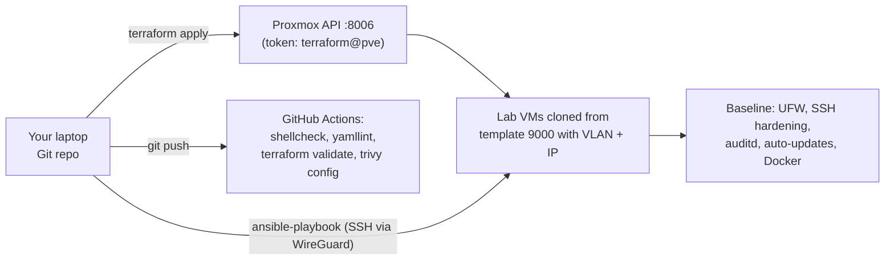

# Project 13: Infrastructure as Code Capstone

> Rebuild your lab from code: Terraform creates the VMs on Proxmox, Ansible configures and
> hardens them, and a CI pipeline lints everything on every push. When an evaluation license
> expires or you break something, you run two commands instead of losing a weekend.

## 1. Goal & career relevance

Cloud security and DevSecOps are where demand is growing fastest (see
[what-employers-want](../../docs/what-employers-want.md)), and they run on infrastructure as
code. Being able to say "my whole lab is reproducible from a Git repo, and security baselines
are applied automatically" is a strong closing story for your portfolio.

**Hiring skills proved:** Terraform, Ansible, Git workflows, CI/CD (GitHub Actions), secrets
handling in code, security-as-code (hardening baselines, scanning), API tokens and least privilege.

## 2. Concepts covered

- Declarative vs. imperative infrastructure; idempotency; drift
- Terraform: providers, resources, variables, `for_each`, state (and why state is sensitive)
- Ansible: inventory, playbooks, modules, handlers, roles, `--check` / `--diff`
- Least-privilege API tokens for automation (a Proxmox role just for Terraform)
- Keeping secrets out of Git (`.tfvars`, Ansible Vault, environment variables)
- CI for infrastructure: lint, validate, scan (shellcheck, yamllint, `terraform validate`, Trivy)

### Learn alongside (read / watch)

| Resource | Why | Time |
|---|---|---|
| [HashiCorp Terraform tutorials: Get Started](https://developer.hashicorp.com/terraform/tutorials) | The official on-ramp | 3 h |
| [bpg/proxmox provider docs](https://registry.terraform.io/providers/bpg/proxmox/latest/docs) | The provider you'll use | 1 h |
| [Ansible: Getting started](https://docs.ansible.com/ansible/latest/getting_started/index.html) + [playbook intro](https://docs.ansible.com/ansible/latest/playbook_guide/playbooks_intro.html) | Configuration management basics | 3 h |
| [MIT Missing Semester](https://missing.csail.mit.edu/) "Version Control (Git)" + "Metaprogramming" | Git and build/CI concepts | 2 h |
| [GitHub Actions quickstart](https://docs.github.com/en/actions/writing-workflows/quickstart) | CI for this repo | 1 h |
| [Trivy docs](https://trivy.dev/) | Scanning images and IaC for misconfigurations | 1 h |
| [MIT 6.033](https://ocw.mit.edu/courses/6-033-computer-system-engineering-spring-2018/) lectures on reliability/automation (optional) | Why reproducibility matters in systems | optional |

## 3. Estimated time

**16 hours.** Terraform 6 h, Ansible 6 h, CI + scanning 2 h, docs 2 h.

## 4. Resources & profile

Runs from **your laptop** (or a LAB-MGMT box) against the Proxmox API; no new VMs beyond what
it recreates. Practice on throwaway VMIDs (e.g. 3xx test clones) before letting Terraform manage
real ones.

## 5. Prerequisites

- [ ] Projects 01, 02, 04 (you've done these steps by hand, so you know what the code automates)
- [ ] Terraform and Ansible installed on your laptop
- [ ] Your laptop reaches the Proxmox API (8006) on the home LAN and lab hosts over WireGuard

## 6. Architecture



## 7. Build steps

### Step 1: A least-privilege API token (30 min)

Never automate as `root@pam`. On the Proxmox host, create a dedicated user, role and token
(exact privilege list in `automation/terraform/README.md`; check the provider docs for your
Proxmox version):
```bash
pveum user add terraform@pve
pveum role add TerraformProv -privs "<privileges from the docs>"
pveum aclmod / -user terraform@pve -role TerraformProv
pveum user token add terraform@pve tf --privsep 0
```
Store the token secret in your password manager. It goes into an **untracked** `terraform.tfvars`
or an environment variable, never Git.

### Step 2: Terraform the lab VMs (5 h)

1. Start from `automation/terraform/` (read every file). The core is one
   `proxmox_virtual_environment_vm` resource with `for_each` over a map of VMs (name, VMID,
   VLAN, IP, RAM, cores, disk), cloning template 9000 with cloud-init.
2. `terraform init` → `terraform plan`. Read the plan line by line before every apply.
3. Apply for **one** test VM first. Check it in the GUI: right VLAN tag, IP, RAM.
4. Add the lab-docker and blue-box definitions. Change a value (RAM) and watch `plan` show an
   in-place update. Delete one from the map and watch `plan` destroy it. That's the power and
   the danger.
5. Discuss state: `terraform.tfstate` contains sensitive data. It's in `.gitignore`. Where would a
   team keep it? (Remote backend with encryption and locking.)

### Step 3: Ansible configuration + hardening (6 h)

1. Inventory (`automation/ansible/inventory.ini`) groups hosts: `docker_hosts`, `blue_boxes`, `all_lab`.
2. The `site.yml` playbook applies a **baseline** to every host: packages, UFW default-deny
   with only the services each group needs, SSH hardening (no root login, no password auth),
   auditd, unattended-upgrades, and a login banner. Then it installs Docker on `docker_hosts`.
3. Run with `--check --diff` first, then for real. Run it a **second time**: nothing should
   change (`changed=0`). That's idempotency, and it's how you know your automation is correct.
4. Re-run `linux_audit.py` (P04) or Lynis before and after: the baseline should move the score.
   That's compliance-as-code.

### Step 4: CI for this repo (2 h)

Copy `automation/github-actions-lint.yml` to `.github/workflows/lint.yml` in your **own**
repo. On every push it runs this repo's `scripts/check-repo.sh` (shellcheck, yamllint, Python
compile, XML/compose checks, link check, secrets heuristic) plus `terraform fmt -check`,
`terraform validate` and a **Trivy** IaC misconfiguration scan. Fix whatever it finds.

### Step 5: Rebuild drill (1 h)

Destroy a non-critical VM (e.g. lab-docker), then recreate it with `terraform apply` +
`ansible-playbook`. Time it. That time goes on your resume.

## 8. Checkpoints

- [ ] Dedicated Proxmox token with a custom role (no root token in automation)
- [ ] `terraform plan/apply` creates and updates lab VMs with correct VLAN/IP/RAM
- [ ] Ansible baseline applied; second run reports `changed=0`
- [ ] Audit score improved by the baseline (before/after recorded)
- [ ] CI pipeline green on your repo
- [ ] Rebuild drill timed

## 9. Exercises

1. What happens if two people run `terraform apply` at the same time with local state? How do
   remote backends prevent it?
2. Find a secret you could accidentally commit in this setup (token, tfvars, state). How does
   each layer (`.gitignore`, CI secret scan, pre-commit hook) catch it?
3. Ansible vs. a Bash script for the same baseline: list three advantages of Ansible.
4. Run `trivy config automation/terraform` and explain each finding. Is it a real issue for
   a home lab?

## 10. Coding exercises

**Before you start:** [Python primer](../../docs/python-primer.md) section 3, plus the HCL and
YAML sections of the Terraform and Ansible docs.

**HCL + YAML: extend the lab.** Add the Wazuh VM (401, BLUE, 5 GB, no balloon) to the Terraform
map and give it its own Ansible group that opens only 443/1514/1515 in UFW. Solution: the
commented entries in `automation/terraform/terraform.tfvars.example` and
`automation/ansible/site.yml`.

**Python: inventory from Terraform.** Write `tf_to_inventory.py` that reads `terraform output
-json` and generates the Ansible inventory, so the two tools never disagree about IPs. Solution:
`automation/python/tf_to_inventory.py`.

## 11. Snapshot / teardown

- Snapshot before letting Terraform touch existing VMs.
- `terraform destroy` only targets what's in its state; double-check the plan.

## 12. Stretch goals

- Build the **Windows templates** with **Packer** (the benheater.com GOAD series shows how).
- Move Terraform state to an encrypted remote backend (e.g. an S3-compatible bucket on a
  NAS).
- Manage OPNsense config as code (backup to Git from P01 is a start).
- Add a pre-commit hook running `gitleaks` or `detect-secrets`.

## 13. Documentation deliverables

| Deliverable | Template |
|---|---|
| Repo README for the IaC (what it builds, how to run it, secrets handling) | `runbook-sop` (suffix `iac`) |
| ADR: Terraform + Ansible vs. Bash scripts | `adr` (suffix `013-iac`) |
| ADR: where state and secrets live | `adr` (suffix `014-state-secrets`) |
| Rebuild drill results | in the runbook |

## 14. Definition of done

- [ ] Checkpoints ticked
- [ ] README/runbook and ADRs written
- [ ] Inventory generator working
- [ ] Resume bullet + path-finder rating

## 15. Resume bullets

- *Codified a segmented homelab with Terraform (bpg/proxmox) and Ansible, rebuilding hosts with
  VLAN placement, cloud-init and a CIS-aligned hardening baseline in under N minutes.*
- *Built a GitHub Actions pipeline linting shell, YAML, Python and Terraform and scanning IaC
  with Trivy; enforced least-privilege API tokens and kept secrets out of version control.*

## 16. References

- [Terraform docs](https://developer.hashicorp.com/terraform/docs) · [bpg/proxmox provider](https://registry.terraform.io/providers/bpg/proxmox/latest/docs)
- [Ansible docs](https://docs.ansible.com/) · [ansible-lint](https://ansible.readthedocs.io/projects/lint/)
- [Trivy](https://trivy.dev/) · [GitHub Actions](https://docs.github.com/en/actions)
- [Proxmox user management (pveum)](https://pve.proxmox.com/wiki/User_Management)
