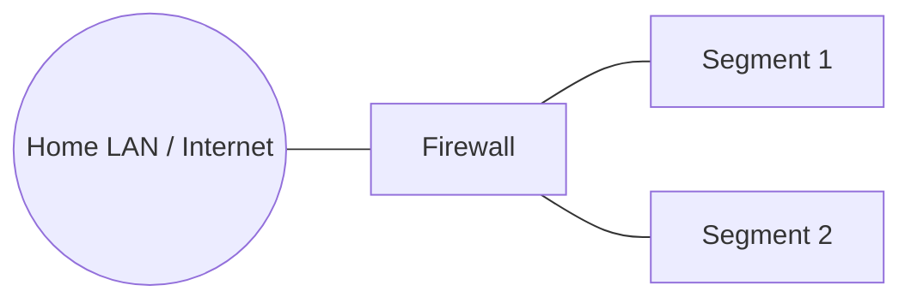

# Network Design: <Lab / Network name>

| Field | Value |
|---|---|
| Author | <you> |
| Version | 1.0 |
| Date | YYYY-MM-DD |
| Status | Draft / Approved / Superseded |

## 1. Executive summary
> 3–5 sentences: what this network is for, how it's segmented, and the main security goals.

## 2. Requirements & constraints
- Functional: <e.g. host red/blue exercises for up to 4 friends>
- Security: <e.g. vulnerable systems must not reach home network or internet>
- Constraints: <16 GB RAM host, single NIC, consumer ISP>

## 3. Topology diagram
> Mermaid or embedded draw.io PNG. Show segments, VLAN IDs, gateways, trust boundaries.

## 4. Address plan (IPAM)
| Segment | VLAN | Subnet | Gateway | DHCP range | DNS | Purpose |
|---|---|---|---|---|---|---|
| | | | | | | |

## 5. Host inventory
| Hostname | VMID | Segment | IP | OS | Role | Owner |
|---|---|---|---|---|---|---|
| | | | | | | |

## 6. Firewall policy matrix
> Rows = source, columns = destination. Then list the actual rules.

| From \ To | | | | Internet | Home |
|---|---|---|---|---|---|
| | | | | | |

### Rule list
| # | Interface | Action | Source | Destination | Port/Proto | Log | Purpose |
|---|---|---|---|---|---|---|---|
| | | | | | | | |

## 7. Trust boundaries & data flows
> Which flows cross boundaries and why they're allowed (e.g., agents → SIEM tcp/1514).

## 8. Services (DNS, DHCP, NTP, VPN)

## 9. Monitoring & logging
> Where firewall logs, IDS alerts and host logs go.

## 10. Risks & open issues
| Risk | Mitigation | Status |
|---|---|---|

## 11. Validation tests
| Test | Expected | Result | Date |
|---|---|---|---|
| ping 192.168.1.1 from TARGETS | blocked | | |

## 12. Change history
| Version | Date | Change | ADR |
|---|---|---|---|
