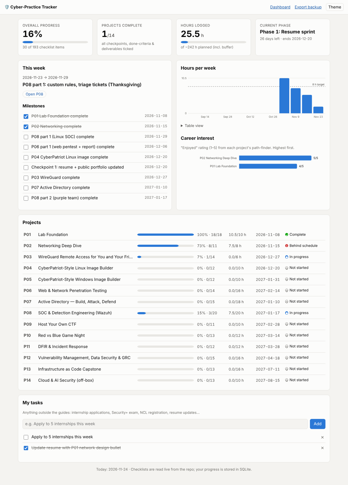
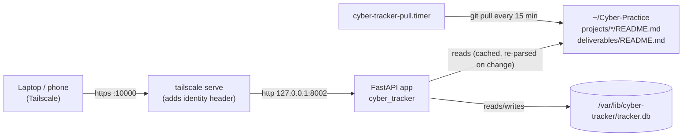

# Cyber-Practice Progress Tracker

A small self-hosted web app for checking off your progress through the projects. It reads the
checklists **straight from this repo**, so it always matches the guides. Your ticks, hours and
ratings are stored in SQLite.

## What gets tracked (automatically)

Anything with a checkbox in a project folder becomes a trackable item, no tracker changes needed:

| Source | What's picked up |
|---|---|
| `projects/NN-*/README.md` | every `- [ ]` line in **any** section (Prerequisites, Checkpoints, Definition of done, or a section you add), grouped under its `##` heading |
| `projects/NN-*/deliverables/README.md` | every row of the deliverables table |
| `projects/NN-*/TASKS.md` *(optional, create it yourself)* | your own extra tasks for that project; use `## headings` to group them |
| a new `projects/15-whatever/README.md` | a whole new project, with its *Estimated time* added to the planned-hours total |

- Push the change and it appears after the next pull (≤ 15 min with the pull timer), or run
  `git -C ~/Cyber-Practice pull` on the server to see it immediately. No restart needed.
- A box ticked **in the file** (`- [x]`, or ☑/✅ in the deliverables table) counts as done and is
  locked in the tracker ("✓ ticked in README.md"); untick it in the file to change it.
- Checkboxes inside ``` code blocks are ignored (they're examples).
- Identical lines get separate checkboxes.
- **Rewording a line resets that one item** (items are identified by their text). Deleting a line
  removes it from the totals.
- A new project has no due date until you add a milestone for it in
  `cyber_tracker/schedule.json` (then restart). The dashboard lists unscheduled projects.



**What it shows**
- Overall %, projects complete, hours logged vs. the ~242 h plan, current phase and days left
- **This week's focus** from the schedule, plus checkable **milestones** with overdue flags
- Per-project progress, hours, due date and status (Complete · In progress · Due this week ·
  Behind schedule · Not started)
- Hours per week (last 12 weeks) against the 8 h/week target
- **Career interest**: your path-finder "enjoyed" ratings, ranked, so you can see which security
  path you like best
- Deliverables show "file created" once `scripts/new-doc.sh` has made the file
- Every project page labels where each group of items comes from (README.md, deliverables, TASKS.md)
- **My tasks** for anything outside the guides (applications, Security+, NCL registration…)
- Export a JSON backup of all your data

## Footprint & placement

| | |
|---|---|
| Runs on | your existing Ubuntu server (next to Cardinal and Footsim) |
| Process | one uvicorn worker, **~55 MB RAM**, idle CPU ≈ 0 |
| Listens on | `127.0.0.1:8002` only (Cardinal = 8000, Footsim = 8001) |
| Reached via | `tailscale serve` on HTTPS port **10000** → `https://cardinal.<your-tailnet>.ts.net:10000` (Cardinal keeps 443, Footsim keeps 8443) |
| Data | `/var/lib/cyber-tracker/tracker.db` (include it in your server backups) |
| Limits | systemd caps it at 200 MB RAM and 25% of one CPU |

## Install (on the Ubuntu server)

```bash
git clone https://github.com/cheath05/cyber-practice.git ~/Cyber-Practice
```

```bash
~/Cyber-Practice/tracker/deploy/install.sh --with-pull-timer
```

The script:
1. creates `tracker/.venv` and installs FastAPI, uvicorn and Jinja2;
2. installs `cyber-tracker.service` (hardened systemd unit) bound to `127.0.0.1:8002`;
3. with `--with-pull-timer`, installs a timer that runs `git pull --ff-only` every 15 min so
   new or edited checklist items show up automatically (the repo must be pullable
   non-interactively: public, or an SSH deploy key);
4. health-checks it and shows your current `tailscale serve` config.

It refuses to use ports 8000/8001 or Tailscale ports 443/8443. Then publish it on your tailnet:

```bash
sudo tailscale serve --bg --https=10000 http://127.0.0.1:8002
```

Check all three apps are still mapped:

```bash
sudo tailscale serve status
```

Open `https://cardinal.<your-tailnet>.ts.net:10000` from your laptop or phone (Tailscale on).

> Use `tailscale serve`, **not** `tailscale funnel`. Funnel would put it on the public
> internet. If your tailnet ACLs restrict ports, allow port 10000 to this machine for your user.

### Optional: only let *you* in

`tailscale serve` adds a `Tailscale-User-Login` header to each request. The tracker can require
yours:

```bash
echo 'CT_ALLOWED_LOGINS=your-tailscale-login@example.com' | sudo tee /etc/cyber-tracker.env
```

```bash
sudo systemctl restart cyber-tracker
```

### Day-to-day

```bash
systemctl status cyber-tracker            # is it running?
journalctl -u cyber-tracker -n 50         # logs
sudo systemctl restart cyber-tracker      # after editing schedule.json
```

Update the code: `git -C ~/Cyber-Practice pull`, then restart the service.

## How it works



- `cyber_tracker/repo_parser.py`: turns the Markdown checklists into items with stable IDs (a hash
  of project + section + text). The footer shows which commit the tracker is reading and when
  the repo was last pulled.
- `cyber_tracker/schedule.json`: phases, weeks and milestones mirrored from
  `docs/schedule.md`, plus `buffer_hours` (planned total = every project's estimate + buffer).
  **Edit it if you re-plan**, then restart.
- `cyber_tracker/db.py`: SQLite tables for checks, hours, ratings and tasks. Parameterized
  queries only (see P06 for why).

## Security design (a mini case study for your portfolio)

| Threat | Control |
|---|---|
| Someone on the internet reaches it | Binds to loopback only; reachable only through `tailscale serve` (tailnet) |
| Another tailnet device/user | Optional `CT_ALLOWED_LOGINS` allowlist using Tailscale identity headers |
| CSRF (a malicious site makes your browser POST) | Every change requires a custom `X-Requested-With` header plus JSON, which browsers can't send cross-site without a CORS preflight the app never approves |
| XSS via task text or guide text | Jinja2 autoescaping; the Markdown subset escapes first; strict CSP (`script-src 'self'`, no inline scripts or styles) |
| Clickjacking | `frame-ancestors 'none'` + `X-Frame-Options: DENY` |
| SQL injection | Parameterized queries everywhere |
| A bug or compromise hurting the host | systemd sandbox (`ProtectSystem=strict`, read-only home, no capabilities, `NoNewPrivileges`), memory/CPU caps |

## Develop & test

```bash
cd tracker && python3 -m venv .venv && .venv/bin/pip install -r requirements-dev.txt
.venv/bin/python -m pytest -q                       # 28 tests: parser, dynamic items, API, CSRF, allowlist, escaping
CT_DB=/tmp/dev.db .venv/bin/uvicorn cyber_tracker.main:app --reload --port 8002
```

`CT_TODAY=2026-11-24` pretends it's a given date (handy for checking the "behind schedule" logic).
